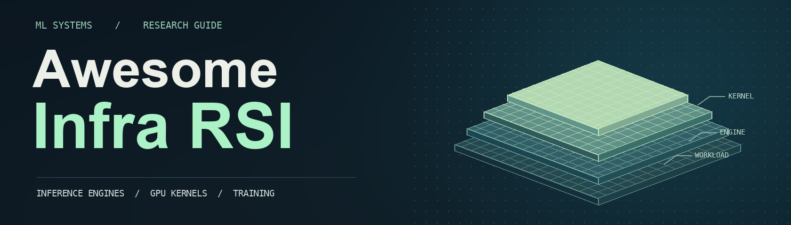

[English](README.md) · [中文](README.zh-CN.md)　|　[Contribute](CONTRIBUTING.md)

**What changes when an AI agent can edit the inference engine itself?** This guide follows recursive self-improvement (RSI) in ML systems through three questions. What can the agent change? Who verifies the result? Where does the improvement show up in the workload?

## Start here

| If you want to understand… | Read this first |
|---|---|
| How one experiment makes the next one possible | **SEIS** passes both engine code and experiment notes to the next session. [Research across sessions](https://nehzux.github.io/SEIS/) |
| How to run enough experiments on a real model | **Together Compiler** keeps model layers resident and tests candidates at two scales. [The persistent engine](https://arxiv.org/abs/2611.14681) |
| Whether a faster engine implies a capable systems agent | **Apple RSI-Inference Bench** scores performance work and new-model support separately. [Two-track leaderboard](https://rsi-inference.com/) |

**Field notes**　[Three experiments in depth](surveys/three-experiments.md) · [Illustrated survey of twelve projects · 中文](surveys/2026-11-inference-infra-rsi.zh-CN.md)

[Inference engines](#engines) · [Production workloads and upstream adoption](#workload) · [Kernel research and integration](#kernel) · [Benchmarks and harnesses](#eval) · [Training and adaptive serving](#adj)

## Inference engines

- **[RSInfer](https://github.com/open-agent-infra/RSInfer)** — An agent can replace serving logic while weights and communication state stay resident. On four SM100 GPUs the team reports 95 live updates over six hours with no process restarts. Promotion is checked in a fresh process. [Engine](https://github.com/open-agent-infra/RSInfer)
- **[SEIS](https://nehzux.github.io/SEIS/)** — What does a second research session gain from the first? Agents inherit code and experiment notes across branches. On one H100, single-request Qwen3-0.6B throughput rose from 594 to 1,942 tok/s over the starting mini-sglang engine. [Paper](https://arxiv.org/abs/2610.04646) · [Code](https://github.com/smth-fun/self-evolving-inference-system)
- **[Together Compiler](https://www.together.ai/blog/together-compiler-continual-compilation-for-ai-inference)** — A few resident layers give agents fast feedback; a larger execution tier tests whether a candidate still works with realistic activations. The paper shows why random inputs can send MoE optimization in the wrong direction. [Paper](https://arxiv.org/abs/2611.14681) · [Engineering report](https://www.together.ai/blog/road-to-together-compiler)
- **[EngineTailor](https://www.infinigence-ai.com/news-updates/256.html)** — A model-specific engine gives the coding agent a small, executable codebase and keeps the full inference test. In one Pi0.5 experiment, attention ran 1.497× faster in isolation while the complete action inference took 56.7 ms longer. [Team report](https://www.infinigence-ai.com/news-updates/256.html) · [APXInf component](https://github.com/infinigence/APXInf)
- **[SkySynth / JITEngine](https://skydiscover-ai.github.io/blog-jitengine.html)** — Agents specialize a model for a particular machine and evolve executable tests alongside it. Checking a speculative Qwen3.6 token cost about 21% of a decode step on an M4 Pro versus 65–73% on an M2, leading the engines to different decoding strategies. [Method](https://skydiscover-ai.github.io/blog-skysynth.html) · [Engines](https://github.com/skydiscover-ai/jitengine)

## Production workloads and upstream adoption

- **[Herschel](https://arxiv.org/abs/2609.40247)** — GPU idle time can originate in another process. On-demand tracing exposed a wait for remote KV creation that could overlap model execution. The resulting fix improved short-context prefill throughput by 3.3–5.7% in affected deployments. [Paper and case studies](https://arxiv.org/pdf/2609.40247v1)
- **[InferenceForge](https://agenteconomics.org/posts/inference-forge)** — A long request in a mixed batch exposed a decode bottleneck. The team evaluates patches on an hour of AgentX traffic and reports 12.8k tok/s/GPU on 8×B300 for Kimi K3 while sustaining at least 30 tok/s per user. [Report](https://agenteconomics.org/posts/inference-forge) · [Scheduler change](https://github.com/jcaip/sglang-fork/pull/3)
- **[InferRSI](https://github.com/InferMatrixLab/InferRSI)** — A frozen workload and independent replay give a candidate a meaningful acceptance test. The Qwen-Image log records an RMSNorm/RoPE fusion that passed its operator test and failed full-image verification. [Code](https://github.com/InferMatrixLab/InferRSI) · [Experiment log](https://github.com/InferMatrixLab/InferRSI/blob/9466bc8d910c9fef55d4a9e23ee1a82950280c30/docs/qwen-image-2.1-turbo-b300.md)
- **[OpenRSI × SGLang-Omni](https://index.openrsi.foundation/blog/2026/openrsi-sglang-omni/)** — Independent reruns and maintainer review turn a research result into an upstream default. The collaboration reports 14 merged PRs across eight models and documents which other changes landed during each performance comparison. [Joint report](https://index.openrsi.foundation/blog/2026/openrsi-sglang-omni/) · [Upstream PR](https://github.com/sgl-project/sglang-omni/pull/2779)

## Kernel research and integration

- **[Sol-H3](https://nvlabs.github.io/Sana/Sol-Engine/Sol-H3/)** — A human-designed coarse-to-fine generator reduces denoising work. An RSI loop then searches fusion and communication choices. The LoRA ablation shows why the fastest BF16 weight merge can change the scene while a consumer-side fusion preserves the tested output. [Paper](https://arxiv.org/abs/2609.35110) · [Code](https://github.com/NVlabs/Sana/tree/sol-engine/models/minimax_h3)
- **[Atrex Kernel Agent](https://github.com/alibaba/atrex-kernel-agent/tree/aka-for-rsi)** — A serving agent submits a kernel contract with the baseline, workload and verifier. It can reconnect and export an accepted candidate while research continues, then measure integration latency in the host and report the adoption decision. [SDK](https://github.com/alibaba/atrex-kernel-agent/tree/aka-for-rsi) · [Task interface](https://github.com/alibaba/atrex-kernel-agent/blob/aka-for-rsi/docs/task-execution.md)

## Benchmarks and harnesses

- **[Apple RSI-Inference Bench](https://github.com/apple-aiml-research/ml-rsi-inference-bench)** — 37 tasks cover new-model support, optimization and regression repair in vLLM and SGLang. In the October 25 snapshot, nine of 15 agents improved performance on average while recording no full passes on new-model support. [Tasks](https://github.com/apple-aiml-research/ml-rsi-inference-bench/tree/main/tasks) · [Leaderboard](https://rsi-inference.com/)
- **[OpenRSI Index / RSI-Harness](https://github.com/OpenRSI-Foundation/OpenRSI-Index)** — The Index defines tasks and their evaluators. The Harness runs long experiments from local Docker to multi-node clusters. The SGLang-Omni tasks show how a published case study becomes a workload another agent can attempt. [Harness](https://github.com/OpenRSI-Foundation/OpenRSI-Index/tree/main/RSI-Harness) · [Task suite](https://github.com/OpenRSI-Foundation/OpenRSI-Index/tree/main/rsi-tasks/SGNOMI)

## Training and adaptive serving

- **[InfraRSI](https://infrarsi.github.io/)** — Training introduces a coupled memory and performance constraint. An out-of-memory trial can be revisited after another patch frees memory. The paper reports a 1.83× geometric-mean training speedup across four workloads over their original configurations. [Paper](https://arxiv.org/abs/2611.11558) · [Implementation](https://github.com/TokenRhythm/InfraRSI)
- **[Evolving Infra](https://inference-rsi.com/)** — Here the agent supplies the workload. The serving system reallocates prefill/decode capacity and retains KV prefixes across context branches at runtime. Its experiments connect serving policies to latency under changing agent traffic. [Paper](https://arxiv.org/abs/2611.12304) · [Code](https://github.com/mit-han-lab/EvolvingInfra)

## Scope and contributions

We welcome papers, engineering reports, benchmarks, and merged implementations that document what changed and how it was evaluated. Include the workload and baseline with performance claims. Replications, regressions, and code releases belong with the original entry. [Contribution guide](CONTRIBUTING.md)

For the execution, state, and control infrastructure that supports RSI across domains, see the complementary [Awesome RSI Infra](https://github.com/usail-hkust/awesome-rsi-infra).
