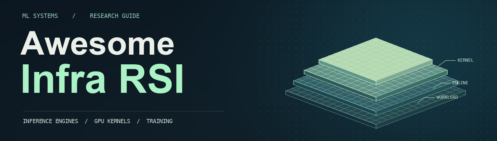

[English](README.md) · [中文](README.zh-CN.md)　|　[投稿](CONTRIBUTING.md)

**当 AI Agent 开始修改推理引擎，什么样的改动值得留下？** 这份清单研究递归自改进（RSI）在机器学习系统中的实践。每个条目追踪三个问题：Agent 能修改哪部分系统，谁来验证，以及收益最终出现在哪一层。

## 从这里开始

| 如果你想知道… | 建议先读 |
|---|---|
| 一轮实验怎样为下一轮创造条件？ | **SEIS** 把代码和实验笔记传给下一轮。[跨轮研究](https://nehzux.github.io/SEIS/) |
| 能否在真实模型上跑足够多的实验？ | **Together Compiler** 让模型层常驻，用两种粒度筛选候选。[常驻引擎](https://arxiv.org/abs/2611.14681) |
| 会改快一个模型，也能接入一个新模型吗？ | **Apple RSI-Inference Bench** 用两条独立计分的赛道回答。[双指标榜单](https://rsi-inference.com/) |

**专题阅读**　[十二项工作的中文图文综述](surveys/2026-11-inference-infra-rsi.zh-CN.md) · [完整英文综述](surveys/2026-11-inference-infra-rsi.md) · [三个实验的英文导读](surveys/three-experiments.md)

[推理引擎](#engines) · [生产负载与上游采用](#workload) · [算子研究与系统接入](#kernel) · [基准与执行框架](#eval) · [训练与运行时自适应](#adj)

## 推理引擎

- **[RSInfer](https://github.com/open-agent-infra/RSInfer)** — Agent 修改服务逻辑时，权重和通信状态可以常驻。团队在四张 SM100 上记录了六小时内 95 次热更新、零进程重启；候选在冷启动实例中完成晋升验收。 [引擎](https://github.com/open-agent-infra/RSInfer)
- **[SEIS](https://nehzux.github.io/SEIS/)** — 把代码与实验笔记一同交给下一轮研究，可以积累哪些独立试错难以得到的改进？单张 H100 上，Qwen3-0.6B 单请求吞吐从起点 mini-sglang 的 594 升至 1,942 tok/s。 [论文](https://arxiv.org/abs/2610.04646) · [代码](https://github.com/smth-fun/self-evolving-inference-system)
- **[Together Compiler](https://www.together.ai/blog/together-compiler-continual-compilation-for-ai-inference)** — 少量常驻层提供快速反馈，更完整的执行环境验证候选在真实激活分布下是否仍然有效。论文里的 MoE 案例解释了为什么随机输入会把研究带向错误方向。 [论文](https://arxiv.org/abs/2611.14681) · [工程报告](https://www.together.ai/blog/road-to-together-compiler)
- **[EngineTailor](https://www.infinigence-ai.com/news-updates/256.html)** — 为当前模型裁出一套小而可运行的引擎，同时保留完整执行路径。Pi0.5 的一次实验中，注意力单测快了 1.497×，完整动作推理却多花 56.7 ms，候选因此被淘汰。 [团队详报](https://www.infinigence-ai.com/news-updates/256.html) · [组件](https://github.com/infinigence/APXInf)
- **[SkySynth / JITEngine](https://skydiscover-ai.github.io/blog-jitengine.html)** — Agent 为特定机器生成引擎，并同步完善可执行测试。Qwen3.6 验证一个投机 token 的额外成本，在 M4 Pro 上约为一次解码步的 21%，在 M2 上为 65–73%，两台机器因此采用了不同策略。 [方法](https://skydiscover-ai.github.io/blog-skysynth.html) · [引擎](https://github.com/skydiscover-ai/jitengine)

## 生产负载与上游采用

- **[Herschel](https://arxiv.org/abs/2609.40247)** — GPU 上的一段空白，原因可能在另一个进程。按需追踪发现引擎在等待远端创建 KV 对象，这段等待可以和模型执行重叠。修复后，相关部署的短上下文 prefill 吞吐提高 3.3–5.7%。 [论文与案例](https://arxiv.org/pdf/2609.40247v1)
- **[InferenceForge](https://agenteconomics.org/posts/inference-forge)** — 混合批次里的一条长请求暴露了解码瓶颈。团队用一小时 AgentX 流量评估修改；在 8×B300 的 Kimi K3 实验中，每用户保持至少 30 tok/s 时，每卡达到 12.8k tok/s。 [报告](https://agenteconomics.org/posts/inference-forge) · [调度改动](https://github.com/jcaip/sglang-fork/pull/3)
- **[InferRSI](https://github.com/InferMatrixLab/InferRSI)** — 冻结工作负载、用独立进程复测，才能判定候选是否值得采用。Qwen-Image 的实验账本保留了一次 RMSNorm/RoPE 融合：算子测试通过，整张图像校验失败。 [代码](https://github.com/InferMatrixLab/InferRSI) · [实验记录](https://github.com/InferMatrixLab/InferRSI/blob/9466bc8d910c9fef55d4a9e23ee1a82950280c30/docs/qwen-image-2.1-turbo-b300.md)
- **[OpenRSI × SGLang-Omni](https://index.openrsi.foundation/blog/2026/openrsi-sglang-omni/)** — 候选经独立复验和维护者评审后进入上游，成为下一轮开发的起点。合作报告覆盖八个模型、14 个已合入 PR，并说明每段性能比较期间还有哪些改动进入主干。 [联合报告](https://index.openrsi.foundation/blog/2026/openrsi-sglang-omni/) · [上游改动](https://github.com/sgl-project/sglang-omni/pull/2779)

## 算子研究与系统接入

- **[Sol-H3](https://nvlabs.github.io/Sana/Sol-Engine/Sol-H3/)** — 两阶段视频生成先在算法上减少去噪计算，再由 RSI 搜索融合和通信实现。LoRA 对照实验显示，最快的 BF16 权重合并改变了生成画面，而消费端融合在测试输入上保住了输出。 [论文](https://arxiv.org/abs/2609.35110) · [代码](https://github.com/NVlabs/Sana/tree/sol-engine/models/minimax_h3)
- **[Atrex Kernel Agent](https://github.com/alibaba/atrex-kernel-agent/tree/aka-for-rsi)** — 系统 Agent 提交算子基线、负载和验收契约。后台研究可以继续，主 Agent 按任务 ID 重连、导出已验收的候选，在宿主中测接入时延并反馈是否采用。 [SDK](https://github.com/alibaba/atrex-kernel-agent/tree/aka-for-rsi) · [任务接口](https://github.com/alibaba/atrex-kernel-agent/blob/aka-for-rsi/docs/task-execution.md)

## 基准与执行框架

- **[Apple RSI-Inference Bench](https://github.com/apple-aiml-research/ml-rsi-inference-bench)** — 37 道题覆盖 vLLM 和 SGLang 上的新模型接入、推理优化和回退修复。10 月 25 日榜单中，15 个 Agent 有 9 个取得了平均加速，却没有一次完整通过新模型接入题。 [题包](https://github.com/apple-aiml-research/ml-rsi-inference-bench/tree/main/tasks) · [榜单](https://rsi-inference.com/)
- **[OpenRSI Index / RSI-Harness](https://github.com/OpenRSI-Foundation/OpenRSI-Index)** — Index 收录任务与验证器，Harness 支持从本地 Docker 到多节点集群的长程执行。公开的 SGLang-Omni 题包把上游案例变成其他 Agent 可重新挑战的工作负载。 [执行器](https://github.com/OpenRSI-Foundation/OpenRSI-Index/tree/main/RSI-Harness) · [题包](https://github.com/OpenRSI-Foundation/OpenRSI-Index/tree/main/rsi-tasks/SGNOMI)

## 训练与运行时自适应

- **[InfraRSI](https://infrarsi.github.io/)** — 训练把速度与显存约束耦合起来。一项配置曾经 OOM，等另一项修改释放显存后仍值得重新组合试验。四个训练负载相对各自原始配置取得 1.83× 几何平均加速。 [论文](https://arxiv.org/abs/2611.11558) · [实现](https://github.com/TokenRhythm/InfraRSI)
- **[Evolving Infra](https://inference-rsi.com/)** — 这里的 Agent 是请求来源。服务系统在运行时重新分配 prefill/decode 资源，并按上下文分支保留 KV 前缀；实验展示了负载构成变化时，这些决策怎样影响请求时延。 [论文](https://arxiv.org/abs/2611.12304) · [代码](https://github.com/mit-han-lab/EvolvingInfra)

## 收录与贡献

优先收录能说明改了什么、如何评测的一手工作。论文、团队工程报告、基准和已合入的实现都可以投稿。计时的工作负载与基线请一起写；后续复现、回退或代码公开，可直接补到原条目。[投稿指南](CONTRIBUTING.md)

想了解支撑 RSI 的执行服务、状态管理和控制机制，可继续阅读相邻主题的 [Awesome RSI Infra](https://github.com/usail-hkust/awesome-rsi-infra)。
