# When agents change the inference engine: a survey of twelve projects

[中文完整版](2026-11-inference-infra-rsi.zh-CN.md) · [Project index](../README.md) · [Three-experiment reading guide](three-experiments.md)

An agent finds a slow attention kernel, writes a faster version, and passes the operator test. What happens next? In an InferRSI image-generation experiment, the complete image failed verification and the candidate was withdrawn. In InferenceForge, the useful attention change emerged only after requests of very different lengths shared a batch. In OpenRSI, even a reproducible improvement still went through upstream review before the next developer could rely on it. These cases suggest three questions for reading this survey: **Where did the problem come from? What workload tested the change? Who decided to adopt it?** [InferRSI experiment log](https://github.com/InferMatrixLab/InferRSI/blob/9466bc8d910c9fef55d4a9e23ee1a82950280c30/docs/qwen-image-2.1-turbo-b300.md) · [InferenceForge report](https://agenteconomics.org/posts/inference-forge) · [OpenRSI joint report](https://index.openrsi.foundation/blog/2026/openrsi-sglang-omni/)

**Scope.** August 21 through November 21, 2026, using the date of a paper, technical release or documented experiment. The sources include six full papers, three team engineering reports, InferRSI’s pinned protocols and logs, the EngineTailor conference abstract and team report, and Apple’s released tasks and leaderboard. Performance measurements are those reported by the respective teams. Captions identify original figures, tables and plots reconstructed from primary data.

| Project | Research question | Evidence to look for |
|---|---|---|
| [Together Compiler](#together) | How quickly can an agent test a real forward pass? | Persistent engine tiers and throughput curves at matched per-user speed |
| [SEIS](#seis) | What does the next research session inherit? | Branching experiments and single-request throughput from 594 to 1,942 tokens/s |
| [OpenRSI × SGLang-Omni](#openrsi) | How does a measured improvement reach upstream users? | Independent verification, maintainer review and 14 merged PRs |
| [InferRSI](#inferrsi) | Does an experiment validate the patch or the research method? | Fresh-process replay and a separate paired knowledge-base protocol |
| [InferenceForge](#forge) | How much traffic can a GPU serve at a minimum user speed? | An hour of AgentX traffic at a 30 tokens/s per-user threshold |
| [EngineTailor](#tailor) | How much of a serving engine does a coding agent need? | A budget-matched comparison using a minimal runnable engine |
| [Herschel](#herschel) | Which production stalls are worth reproducing? | Cross-process traces that explain otherwise idle GPU time |
| [SkySynth / JITEngine](#jit) | What changes when the same model moves to another machine? | Different speculation costs on the M2 and M4 Pro |
| [Evolving Infra](#evolving) | How does the cluster respond when agent traffic changes? | Online prefill/decode allocation and KV retention under changing load |
| [InfraRSI](#training) | Which additional constraints matter for training? | Joint search under workload, loss and memory constraints |
| [Apple RSI-Inference Bench](#apple) | Can an agent that improves speed also add model support? | Separate scores from the same real-engine benchmark |
| [Sol-H3](#solh3) | How much work can be removed, and which outputs must match? | Full-pipeline timings and a controlled LoRA precision comparison |

The first eight projects and Sol-H3 use agents to develop or validate inference software. Apple evaluates agents doing that work. Two neighboring problems help define the scope. In Evolving Infra, agents are the clients and the serving system adapts at runtime. InfraRSI applies joint search and independent verification to training.

---

## 1. Together Compiler and the cost of testing a real forward pass

Together AI · November 10 preprint

A single kernel is cheap to time, but random inputs can hide the uneven expert loads of a mixture-of-experts (MoE) model. Restarting the whole service preserves that distribution at the cost of loading the weights for each trial. Together Compiler (TKCC) keeps model layers resident while agents propose alternative forward passes for a specific deployment. A fast tier uses a few layers to screen candidates. A larger tier checks them against more representative activations. A cost model seeds the parallelism search, and the chosen forward pass is exercised across concurrency levels.

**Results.** Across the models and hardware evaluated, token throughput reached up to 2.6× the best published InferenceX result used for comparison. The NVIDIA and AMD panels use AgentX traffic. The Trainium2 panel uses a synthetic multi-turn workload. Each panel traces a trade-off between total throughput and the decode rate an individual user experiences.

**Availability.** Sections 3–5 document the compiler design, baselines and measurement protocol. The public materials reviewed describe the system and selected implementations. A public release of the complete compiler and search service could not be verified. [Paper](https://arxiv.org/pdf/2611.14681v1) · [Engineering report](https://www.together.ai/blog/together-compiler-continual-compilation-for-ai-inference) · [Design retrospective](https://www.together.ai/blog/road-to-together-compiler)

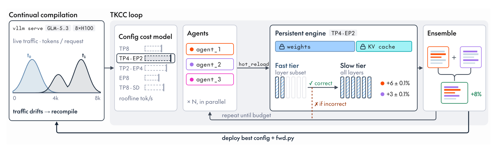

Figure 1 of the paper. The traffic and hardware on the left determine where search starts. Candidates share the weight-loading cost of the engine in the middle. [Original figure, p. 2](https://arxiv.org/pdf/2611.14681v1#page=2)

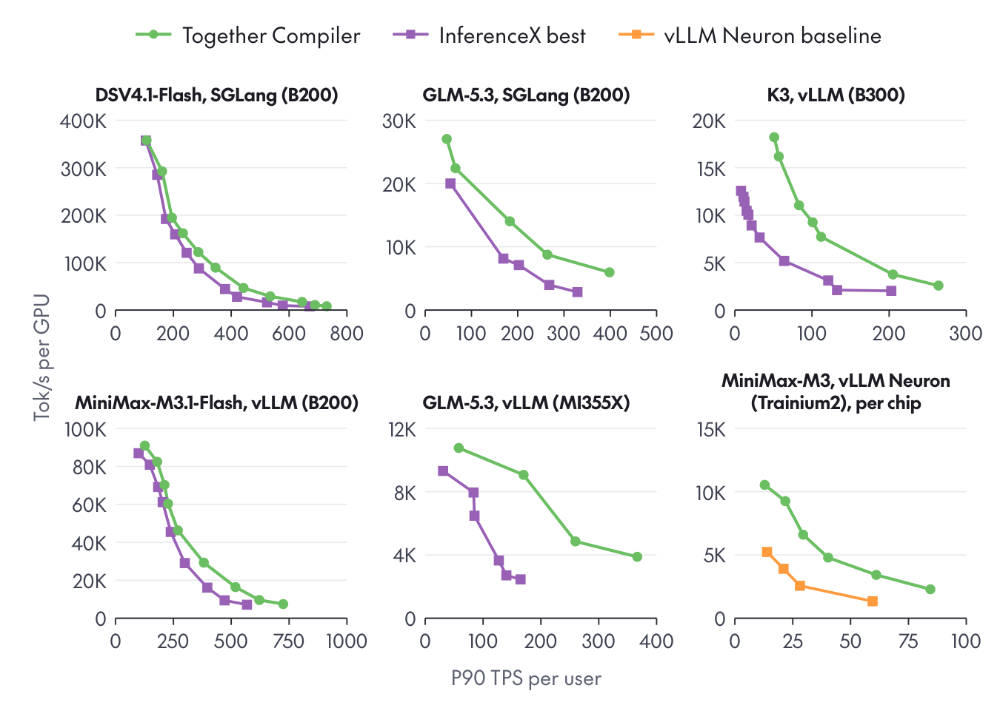

Figure 7. Pick a P90 per-user token rate on the horizontal axis, then compare the throughput per accelerator at that point. The peak of a curve can occur at a different level of interactivity. [Original figure, p. 12](https://arxiv.org/pdf/2611.14681v1#page=12)

---

## 2. SEIS and what a research session inherits

University of Chicago · October 3 preprint

SEIS holds the coding agent fixed and starts it from a working mini-sglang engine. A session leaves behind both code and a report of its experiments. The authors compare independent attempts, chains of sessions on the same branch, and branches that periodically exchange findings. Their strongest engine combined earlier kernel and execution-path changes with a decoding strategy demonstrated on another branch. This inheritance matters when a promising idea only becomes viable after several earlier changes.

**Results.** On one H100 with Qwen3-0.6B, median throughput rose from 594 to 1,942 tokens/s (3.27× over the initial mini-sglang). The natural-length workload served 100 requests one at a time and included prefill. Turning off speculative decoding still left a 3.08× speedup. The authors separately evaluated math and retrieval accuracy on the resulting engine.

**Availability.** The engine, experiment scripts and generated materials are public. The implementation repository is the entry point for reproducing runs. [Paper](https://arxiv.org/pdf/2610.04646v1) · [Project](https://nehzux.github.io/SEIS/) · [Implementation and scripts](https://github.com/smth-fun/self-evolving-inference-system)

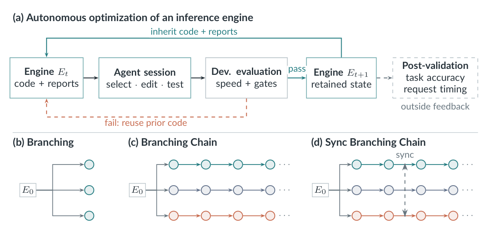

Figure 2. The lower row shows the three ways later sessions can receive earlier work. The upper row distinguishes the development checks used during search from subsequent validation. [Original figure, p. 3](https://arxiv.org/pdf/2610.04646v1#page=3)

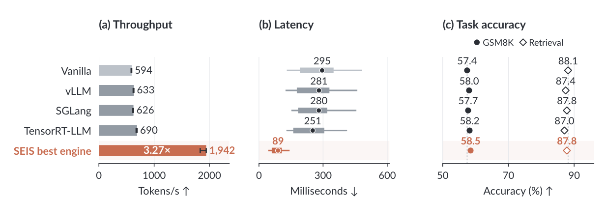

Figure 1. The 3.27× figure uses the original mini-sglang as its denominator. The chart also gives measurements for three established engines, so the reader can compare absolute performance. [Original figure, p. 2](https://arxiv.org/pdf/2610.04646v1#page=2)

---

## 3. OpenRSI × SGLang-Omni and the path to an upstream merge

OpenRSI Foundation and SGLang-Omni · November 9 joint report

A serving library that runs many models needs to know which models benefit from a patch and whether to enable it by default. The collaboration turned proposed improvements into executable tasks with a baseline, verifier and budget. Agents experimented in separate workspaces. Independent reruns and maintainer review preceded a merge. The Qwen3-TTS work on prefill and vocoder graph reuse illustrates what becomes available to the next contributor once an experiment lands in the main branch.

**Results.** The report covers eight models and 14 merged pull requests. For each model, the authors compare the main branch before its first relevant PR with the version after its last. Some intervals also contain unrelated contributions and default changes. Serving mode matters even on the same GPU: Fish S2-Pro gained 9.6% in non-streaming throughput on H100 and 0.3% in streaming throughput.

**Availability.** The tasks, harness, task-construction instructions and upstream changes are public. [Joint report](https://index.openrsi.foundation/blog/2026/openrsi-sglang-omni/) · [SGLang-Omni tasks](https://github.com/OpenRSI-Foundation/OpenRSI-Index/tree/main/rsi-tasks/SGNOMI) · [RSI-Harness](https://github.com/OpenRSI-Foundation/OpenRSI-Index/tree/main/RSI-Harness) · [Upstream PR](https://github.com/sgl-project/sglang-omni/pull/2779)

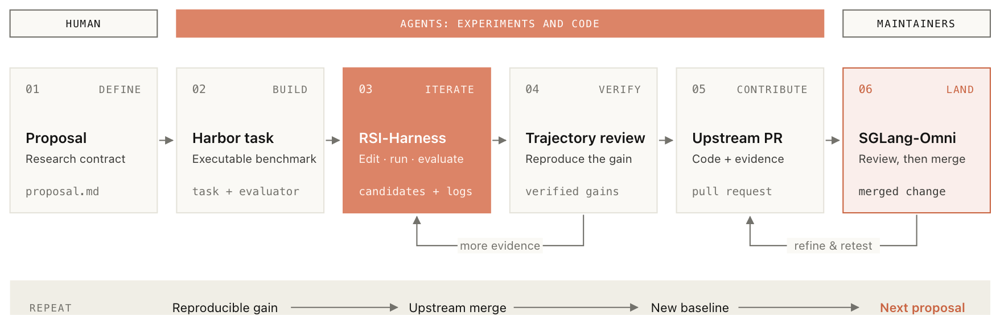

Figure 2 of the joint report. The rightmost handoff determines which implementation future upstream tasks will inherit. [Original figure](https://index.openrsi.foundation/blog/2026/openrsi-sglang-omni/)

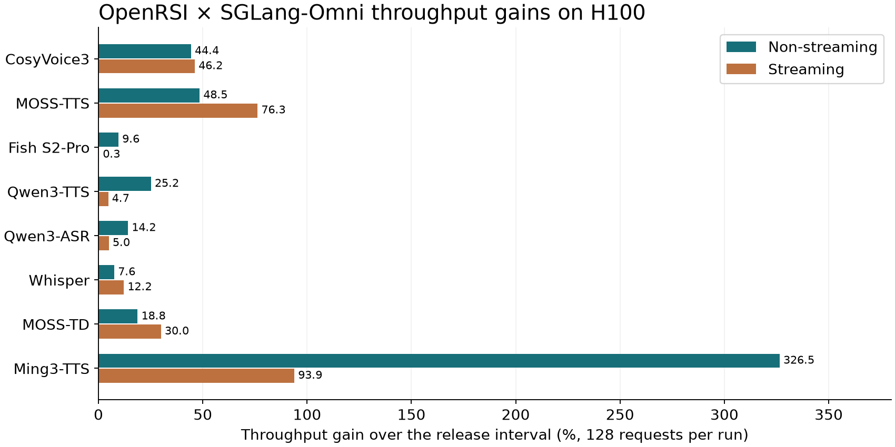

Redrawn from the H100 columns of Table 1. Each run serves 128 requests. The largest bar, Ming3-TTS, spans an interval that included 28 other PRs. It measures the gain across that release interval. [Table and attribution notes](https://index.openrsi.foundation/blog/2026/openrsi-sglang-omni/)

---

## 4. InferRSI evaluates both a candidate and the method that found it

InferMatrixLab · October experiments, repository snapshot reviewed November 21

InferRSI supplies a workbench for an existing inference engine. An agent forms a hypothesis and edits the code. The harness holds the model, inputs, baseline and quality checks fixed, then retests the selected candidate in a fresh process. A second protocol asks whether a knowledge base helps the researcher: two independent agents get the same task with retrieval enabled or disabled. Comparing their final implementations, time and resource use can test the value of prior experience.

**Results.** An RMSNorm and RoPE fusion passed its operator test but failed full-image verification in the Qwen-Image-2.1-Turbo log, so the agent withdrew it. The accepted combination reduced end-to-end HTTP latency from 384.16 to 266.60 ms (30.60%) on four B300s, with warm execution, a repeated prompt and concurrency one. All 44 evaluation and held-out RGBA outputs matched pixel for pixel. That measurement establishes the effect of the code changes. The separate paired-campaign protocol addresses the knowledge-base question.

**Availability.** The Apache-2.0 repository includes the workbench, frozen protocols, trial logs, example scripts and upstream patches. [Pinned repository](https://github.com/InferMatrixLab/InferRSI/tree/9466bc8d910c9fef55d4a9e23ee1a82950280c30) · [Workflow](https://github.com/InferMatrixLab/InferRSI/blob/9466bc8d910c9fef55d4a9e23ee1a82950280c30/docs/optimization-workflow-unification.md) · [Paired knowledge-base protocol](https://github.com/InferMatrixLab/InferRSI/blob/9466bc8d910c9fef55d4a9e23ee1a82950280c30/docs/benchmark-comparison.md) · [Case log](https://github.com/InferMatrixLab/InferRSI/blob/9466bc8d910c9fef55d4a9e23ee1a82950280c30/docs/qwen-image-2.1-turbo-b300.md)

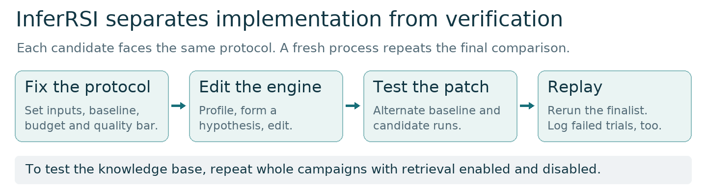

Diagram based on the project protocol. The lower line describes an additional experiment requiring two complete research campaigns. [Protocol](https://github.com/InferMatrixLab/InferRSI/blob/9466bc8d910c9fef55d4a9e23ee1a82950280c30/docs/benchmark-comparison.md)

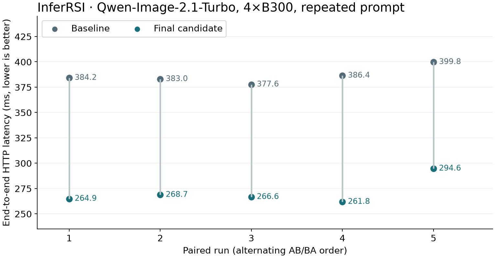

Redrawn from the final H19 log. Each point is the mean of three requests. The reported latency is the median of five such means for each implementation. The fifth pair shows why reporting the individual runs is useful. [Five paired measurements](https://github.com/InferMatrixLab/InferRSI/blob/9466bc8d910c9fef55d4a9e23ee1a82950280c30/docs/qwen-image-2.1-turbo-b300.md)

---

## 5. InferenceForge optimizes throughput at a user-visible decode rate

Agent Economics · November 9 engineering report

How many tokens can a GPU deliver while each user still receives at least 30 tokens/s? The agent ran an hour of AgentX traffic against a SGLang fork, using cache statistics and layer profiles to guide its edits. One bottleneck appeared when a single very long request shared a batch with short ones. The old attention implementation chose its work partition from the batch size. Giving the long request more parallel work removed a delay that every request in the step had been paying.

**Results.** After nine iterations over three days, Kimi K3 on a single node with eight B300s reached 12.8k tokens/s/GPU at the 30 tokens/s per-user threshold. The team reports a 43% gain over the best published AgentX result at that threshold, 8.9k tokens/s/GPU. Other changes included a parallel scan for linear attention and FP8 KV packing.

**Availability.** The SGLang fork and PRs for the three main changes are public. The engineering report describes the experiment controller. A separate public implementation of the complete controller could not be verified. [Engineering report](https://agenteconomics.org/posts/inference-forge) · [SGLang fork](https://github.com/jcaip/sglang-fork) · [Long-request splitting](https://github.com/jcaip/sglang-fork/pull/3) · [Parallel scan](https://github.com/jcaip/sglang-fork/pull/1) · [KV packing](https://github.com/jcaip/sglang-fork/pull/2)

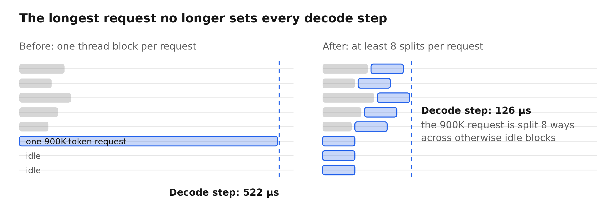

Figure 2 of the team report. A 900K-token request set the critical path under the old split. Repartitioning the work reduced decode-step time in this example from 522 to 126 µs. [Design and implementation](https://agenteconomics.org/posts/inference-forge)

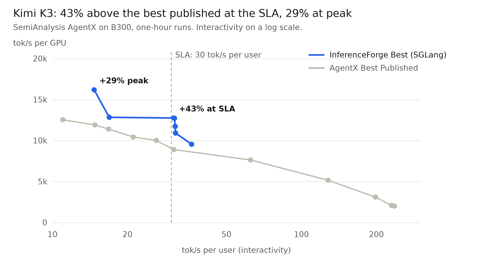

Figure 5. At 30 tokens/s per user, read the sustainable throughput on the vertical axis. The highest point of the curve corresponds to a different concurrency trade-off. [Results and baseline](https://agenteconomics.org/posts/inference-forge)

---

## 6. EngineTailor gives the agent a smaller, runnable engine

Infinigence and collaborators · DAI 2026 accepted abstract and November technical report

Reading shared code consumes budget even when only one model and device matter. EngineTailor produces a runnable engine for the target deployment. Its Qwen3 instance loads weights, manages the cache, runs the model and returns outputs in 28 files and 3,275 lines. A manager selects a measured bottleneck, workers experiment in separate checkouts, and candidates return to the full inference path. In one Pi0.5 trial an attention microbenchmark improved by 1.497×, yet a complete action inference took 56.7 ms longer. The candidate was rejected.

**Results.** Five direct attempts on SGLang cost about $81.39 combined and changed both prefill and decode by less than 1%. With a similar optimization budget, the target engine improved short-sequence prefill by 3.10–4.05× and long-sequence prefill by 1.25–1.41×, while preserving decode performance. These ratios use the specialized engine’s own starting point after initial performance alignment.

**Availability.** The DAI abstract and team report are public. The APXInf component is available under Apache-2.0 and includes a merged Clef backend. A public repository for the complete EngineTailor framework could not be verified. [DAI abstract](https://www.adai.ai/dai/2026/accepted-papers.html#:~:text=EngineTailor) · [Team report](https://www.infinigence-ai.com/news-updates/256.html) · [APXInf component](https://github.com/infinigence/APXInf) · [Clef integration](https://github.com/infinigence/ApxInf/pull/137)

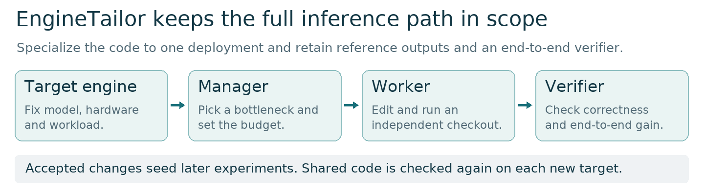

Diagram based on the team report. Narrowing the editable codebase still leaves the worker with a full inference entry point and the verifier with end-to-end measurements. [Workflow description](https://www.infinigence-ai.com/news-updates/256.html)

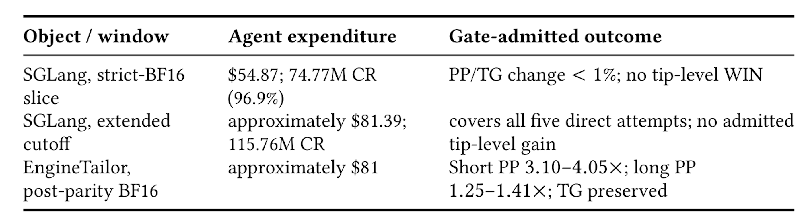

Original table from the team report. The last column separates short and long prefill from generation. The target engine’s row identifies the post-parity starting point used to compute its gains. [Original table](https://www.infinigence-ai.com/news-updates/256.html)

---

## 7. Herschel traces a GPU stall back to its cause in production

Alibaba · September 30 preprint

A gap on a GPU timeline tells an engineer when the GPU was idle. Herschel asks which process made it wait. Hprof attaches briefly to running processes and can collect Python stacks, CPU activity and cross-process events as needed. In one deployment, a worker was idle because the engine process waited for a remote KV object to be created. The engine only needed that object when it saved the cache. Overlapping creation with model execution removed the wait. Once the team can reproduce the triggering conditions, agents implement and test changes in a controlled environment and experts review them for deployment.

**Results.** Over six months, the team collected about 17,000 traces across more than 120 model variants and more than ten accelerator types. Of those traces, 23% matched at least one known inefficiency pattern. Overlapping KV creation improved short-context prefill throughput by 3.3–5.7% in the affected configurations and reached about 50 deployments. A separate Paged Attention change reduced operator duration by about 61% and time per output token by 8–32% in the relevant deployments.

**Availability.** The paper describes profiler attachment, event correlation, cases and deployment statistics. A public release of the full Herschel/Hprof stack could not be verified. [Paper and versions](https://arxiv.org/abs/2609.40247) · [Full text](https://arxiv.org/pdf/2609.40247v1)

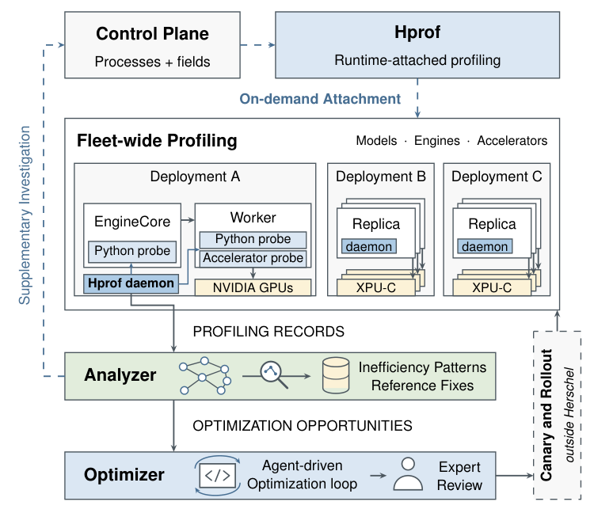

Figure 3. The first observations identify a process worth inspecting. The profiler can then collect additional events there while keeping observation windows short. [Original figure, p. 4](https://arxiv.org/pdf/2609.40247v1#page=4)

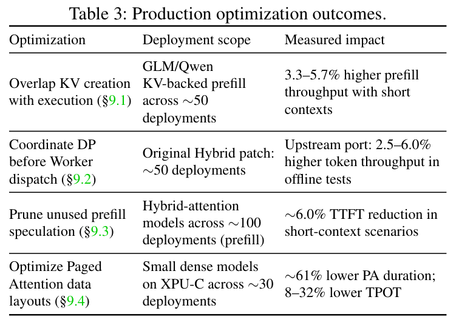

Table 3. Each row identifies an intervention, its scope and its measured impact. The Paged Attention row connects an operator-level change to a service metric for the same intervention. [Original table, p. 9](https://arxiv.org/pdf/2609.40247v1#page=9)

---

## 8. SkySynth and JITEngine specialize one model for two machines

Berkeley Sky Computing Lab and collaborators · November 4 JITEngine release

SkySynth evolves candidate programs alongside tests that check them. JITEngine applies the approach to three models on two Macs. Work on the second machine starts from the first engine and rechecks device-specific assumptions. For Qwen3.6, verifying a speculative token added about 21% of one decode step on the M4 Pro and 65–73% on the M2. The M4 Pro engine could use speculation profitably. On the M2, the agent found better returns in expert-weight access and GPU command submission.

**Results.** For single-user decode, Flash-Next on the M4 Pro achieved 32.9 tokens/s versus slotstream’s 12.1. Qwen3.6 on the M2 achieved 44.9 versus 32.9 for llama.cpp with multi-token prediction. At 252K context on the M4 Pro, Flint reached 27.7 versus 22.6 for rec. Each pair compares engines serving the same model on the same machine.

**Availability.** The SkyDiscover research framework and generated JITEngine implementations are public under Apache-2.0. The two team reports describe the synthesis method and the hardware-specific results. [SkySynth method](https://skydiscover-ai.github.io/blog-skysynth.html) · [JITEngine report](https://skydiscover-ai.github.io/blog-jitengine.html) · [Research framework](https://github.com/skydiscover-ai/skydiscover) · [Engine implementations](https://github.com/skydiscover-ai/jitengine)

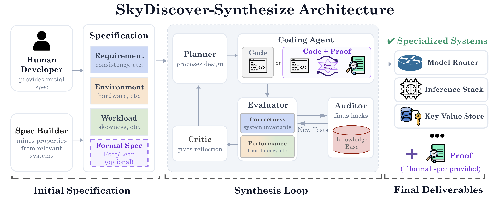

Figure 2 of the SkySynth report. In the Mac case study, executable tests check outputs and device behavior as the implementation changes. [Original architecture](https://skydiscover-ai.github.io/blog-skysynth.html)

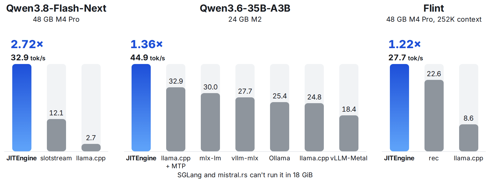

Figure 1 of the JITEngine report, shown in its final animation frame. Each group has its own model, device, deployment constraints and competing implementations. [Original comparison](https://skydiscover-ai.github.io/blog-jitengine.html)

---

## 9. Evolving Infra reallocates compute and preserves reusable context at runtime

Georgia Tech, UIUC, Berkeley, MIT and collaborators · November 9 preprint, revised November 12

Coding, math and computer-use agents make different demands on prefill and decode as they run. They also branch or discard context. A fixed split of nodes can leave requests queued at one stage, and switching a node’s role can evict a prefix that a live branch will soon need. Evolving Infra decouples the node’s compute role from KV ownership. An online planner adjusts the prefill/decode split. A distributed KV manager uses branch liveness to guide eviction and fetches retained state asynchronously. Here agents generate the traffic that the serving system adapts to.

**Results.** The authors replay workloads with GLM-5.2 and Kimi K2.6 on up to 256 GB300 GPUs. Against NVIDIA Dynamo, the largest reported reductions were 4.1× in mean end-to-end request latency and 14× in P95 time to first token. Mean end-to-end latency improved in every configuration in Figure 6. Tail latency varied with workload and concurrency, so each maximum describes a particular comparison.

**Availability.** The implementation and run instructions are public under the MIT license. Coauthors include Song Han and Ion Stoica. [Project](https://inference-rsi.com/) · [Full paper](https://arxiv.org/pdf/2611.12304v2) · [Code](https://github.com/mit-han-lab/EvolvingInfra)

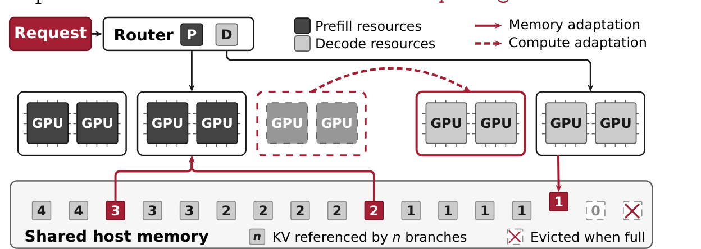

Architecture detail from Figure 1. A node can change its compute role while the KV manager makes a separate decision about which prefixes to retain. [Original figure, p. 1](https://arxiv.org/pdf/2611.12304v2#page=1)

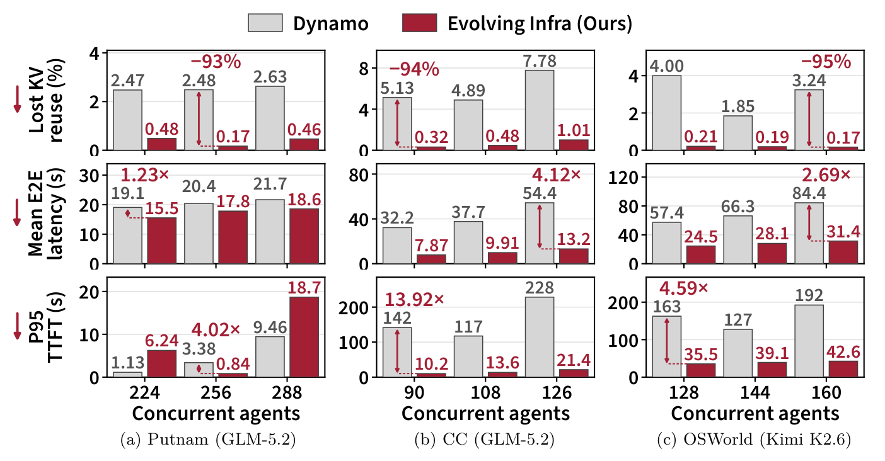

Figure 6. Each column is a workload. Reading down the column connects lost cache reuse with mean and tail latency at each concurrency level. [Original figure, p. 11](https://arxiv.org/pdf/2611.12304v2#page=11)

---

## 10. InfraRSI reuses information from failed training experiments

InfraRSI Team / TokenRhythm · November 8 preprint

Training settings interact. A fused operator or communication setting may reduce step time and still exceed device memory when tried on its own. InfraRSI fixes workload, loss checks and timing rules, measures cluster noise, then searches launch parameters and source patches together. An out-of-memory trial provides a lower bound on the memory the configuration needs. When a later change frees memory, the system can try the combination again. Final candidates run back to back with the baseline. Experience transferred to a new machine is requalified there.

**Results.** Across four single-node or multi-node dense and MoE workloads, training speed improved by a geometric mean of 1.83× over their original configurations, with a maximum of 2.75×. Mean model FLOPs utilization (MFU) rose from 17.4% to 30.0%. In the same experiment the geometric mean speedups for OptiCo, Auto-Research and RE-Bench were 1.23×, 1.34× and 1.37×.

**Availability.** The project publishes the research agent, execution code and tests. At the review snapshot the repository root did not list a standard license. [Project](https://infrarsi.github.io/) · [Full paper](https://arxiv.org/pdf/2611.11558v1) · [Implementation](https://github.com/TokenRhythm/InfraRSI)

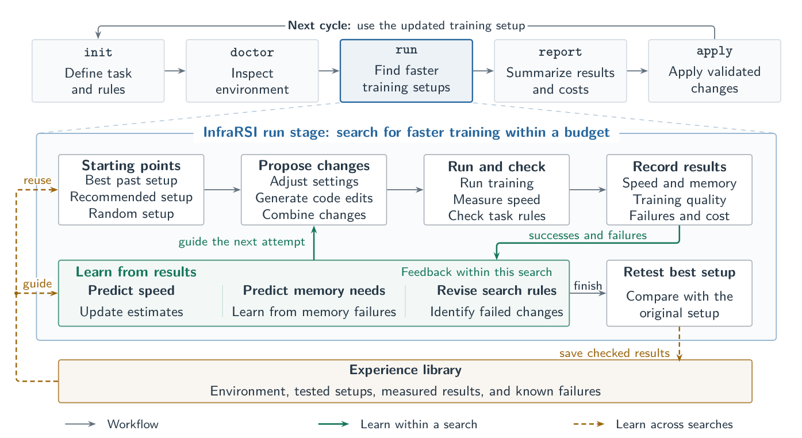

Figure 1. Workload and numerical checks are fixed before search. Only a verified change proceeds to the source tree. [Original figure, p. 2](https://arxiv.org/pdf/2611.11558v1#page=2)

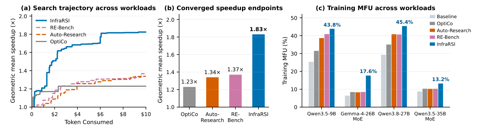

Figure 2. Read panel (a) for progress during search, panel (b) for geometric mean speedup, and panel (c) for final hardware utilization by workload. [Original figure, p. 12](https://arxiv.org/pdf/2611.11558v1#page=12)

---

## 11. Apple RSI-Inference Bench separates model support from performance work

Apple AIML Research · October 16 code release, October 25 leaderboard snapshot

Can an agent that speeds up an existing model also bring up a new architecture? Apple places both tasks in one benchmark and reports their scores separately. Each task starts with a pinned vLLM or SGLang revision, a target model and one to eight GPUs. The agent has up to eight hours to read, edit and measure offline. An independent verifier then builds the submitted engine, serves the model and exercises hidden cases. Other teams can run agents against the same initial conditions. [Evaluation protocol](https://github.com/apple-aiml-research/ml-rsi-inference-bench/blob/1a38072fbe284234c874356b86c9df666a5a79a3/README.md)

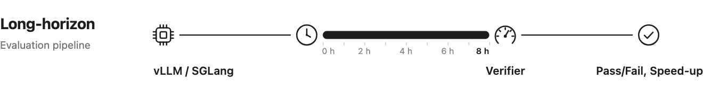

The official evaluation diagram assigns the GPU and time budget to the development phase. Rebuilding and running the submission lets the verifier compare agents on the behavior of their completed engines. [Official workflow](https://github.com/apple-aiml-research/ml-rsi-inference-bench/blob/1a38072fbe284234c874356b86c9df666a5a79a3/assets/g-rail-light.svg)

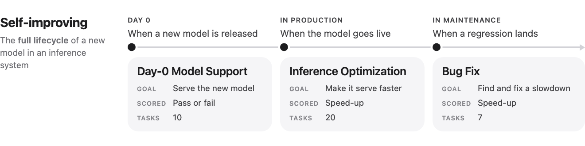

Ten of the 37 tasks cover day-zero model support and score pass@1, averaged across tasks. Twenty optimization tasks and seven regression-repair tasks start from runnable baselines. Their score is the geometric mean of per-task speedups, with a correctness failure counted as 1.00×. [Official task diagram](https://github.com/apple-aiml-research/ml-rsi-inference-bench/blob/1a38072fbe284234c874356b86c9df666a5a79a3/assets/g-lifecycle-light.svg) · [Scoring rules](https://github.com/apple-aiml-research/ml-rsi-inference-bench/blob/1a38072fbe284234c874356b86c9df666a5a79a3/README.md)

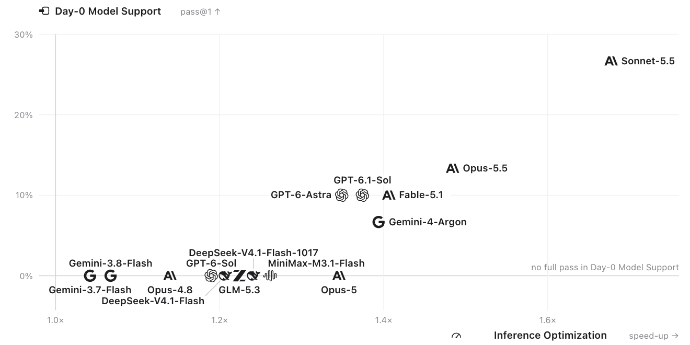

In the October 25 snapshot, Sonnet-5.5 reached 1.68× on optimization and 26.7% pass@1 on new-model support. Nine of the 15 agents obtained a geometric mean speedup above 1× while recording zero full passes on support. Those nine appear along the bottom of the plot. A team hiring an agent to bring up a new architecture would learn little from throughput alone. [Interactive leaderboard](https://rsi-inference.com/) · [Snapshot and data](https://github.com/apple-aiml-research/ml-rsi-inference-bench/blob/1a38072fbe284234c874356b86c9df666a5a79a3/docs/leaderboard.html)

**Availability.** The official repository contains tasks, execution tooling, scoring documentation and the leaderboard snapshot, under the Apple Sample Code License. [Pinned repository](https://github.com/apple-aiml-research/ml-rsi-inference-bench/tree/1a38072fbe284234c874356b86c9df666a5a79a3) · [License](https://github.com/apple-aiml-research/ml-rsi-inference-bench/blob/1a38072fbe284234c874356b86c9df666a5a79a3/LICENSE)

---

## 12. Sol-H3 reduces the work of generation, then optimizes the work that remains

NVIDIA Research · September 28 technical report on MiniMax-H3 video and audio generation

Early video diffusion steps establish scene layout. Later steps supply fine detail. The designers of Sol-H3 exploit this difference by drafting at low resolution and refining at the target resolution. A learned translator connects the two latent spaces, avoiding a decode to pixels followed by a second encode. The RSI loop profiles implementations, searches fusion, layout and communication choices, and checks candidates against the relevant reference. The report identifies the architectural decisions made by people and the implementation choices explored by the agent. [Paper, §§3 and 7](https://arxiv.org/html/2609.35110v1) · [Project page](https://nvlabs.github.io/Sana/Sol-Engine/Sol-H3/)

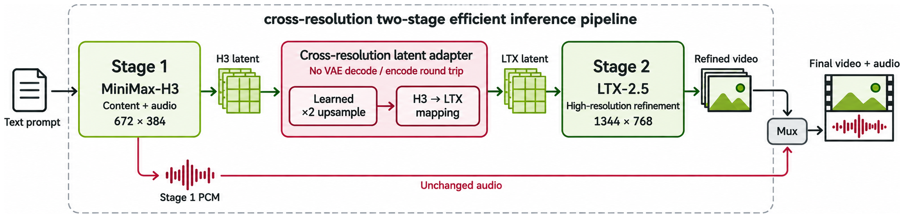

Figure 2. Stage one drafts the scene at 672 × 384. An upscaler and latent translator prepare it for refinement at 1344 × 768. The intermediate representation stays in latent space. [Original figure 2](https://arxiv.org/html/2609.35110v1#S3.F2)

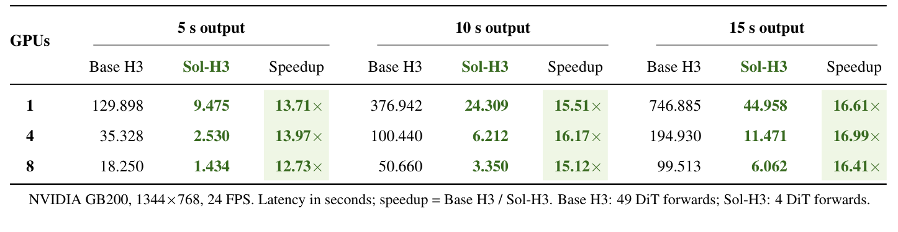

Table 1 fixes output resolution and 24 FPS. On eight GB200s, a five-second video took 1.434 s versus 18.250 s (12.73×), and a fifteen-second video took 6.062 s versus 99.513 s (16.41×). The comparison uses four versus 49 denoising evaluations and times text encoding through audio/video decode and synchronization. Loading, compilation, warmup and MP4 encoding fall outside the timed interval. [Original table 1](https://arxiv.org/html/2609.35110v1#S6.T1)

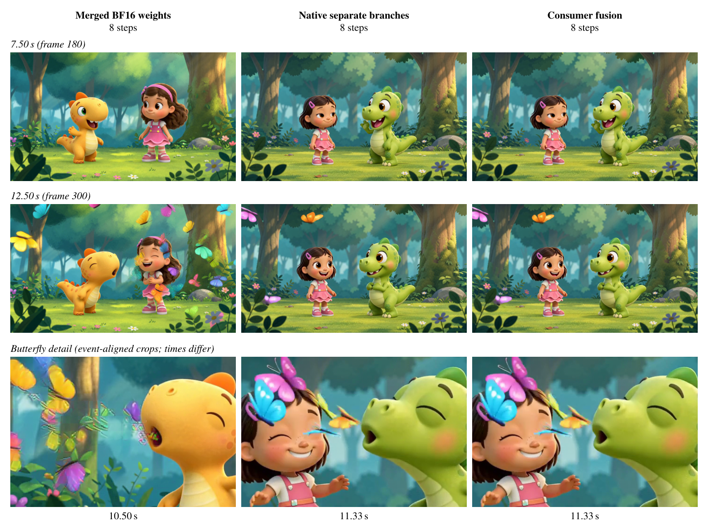

Figure 8 shows why the output belongs in the acceptance test. Pre-merging BF16 weights changed when the butterflies appeared. The native branches and consumer-side fusion agreed byte for byte on this generation. Table 5 gives median pipeline times over eight denoising evaluations on four GB200s. The authors measured 26.283 s for native branches, 25.589 s for consumer fusion and 24.785 s for pre-merged weights. [Original figure 8](https://arxiv.org/html/2609.35110v1#S6.F8) · [Timing in table 5](https://arxiv.org/html/2609.35110v1#S6.T5)

**Availability.** The authors publish MiniMax-H3 inference code, hardware-specific run directories, LoRA fusion notes and tests on the sol-engine branch of NVlabs/Sana. [Pinned source](https://github.com/NVlabs/Sana/tree/cf67a3acad7511acb85053e56a05e5dd24c82ba0/models/minimax_h3) · [Paper PDF](https://arxiv.org/pdf/2609.35110v1)

---

## What carries across these projects?

**The workload determines which question an experiment can answer.** SEIS can afford to revisit small-model, single-request inference on one H100 many times. InferenceForge needs heterogeneous requests to reveal the one long sequence holding up a batch. Herschel starts from a production stall and works backward to the conditions that reproduce it. Each workload makes a different claim measurable: how fast an execution path can become, how much traffic a service can handle at an interactive rate, or how often a particular inefficiency matters in production.

**Different research processes accumulate different things.** SEIS passes code and experiment reports to the next session. InferRSI proposes a controlled comparison to test whether retrieved experience helps. OpenRSI puts a reviewed change into the shared upstream branch. A faster candidate, a more effective researcher and a better default for all users are distinct outcomes. Evidence for one leaves the others open.

**System and kernel research meet at the application’s adoption decision.** A systems agent in RSInfer can observe actual call frequencies, layouts, routing and service latency. It can use those observations to define the task and its acceptance conditions. A specialist kernel agent can then profile, edit and rerun the candidate against that contract. Once the source and per-case results return, the systems agent can remove adapter overhead and measure the entire request path. EngineTailor’s Pi0.5 case gives that division of responsibility a concrete test: the attention microbenchmark sped up by 1.497×, while complete action inference took 56.7 ms longer.

For a presentation, **Herschel → Together Compiler → SEIS → OpenRSI** follows one development process from discovering a problem through cheaper trials and accumulated research to upstream adoption. **InferenceForge and Evolving Infra** then illustrate two ways to improve service under agent traffic: a development agent modifies the engine offline in the first, while the running engine reallocates resources in the second.

[Back to the project index](../README.md) · [阅读中文版](2026-11-inference-infra-rsi.zh-CN.md)
