# 当 Agent 开始改推理引擎：十二个近期项目的设计与实证

[Full English edition](2026-11-inference-infra-rsi.md) · [中文项目索引](../README.zh-CN.md)

**研究窗口：2026 年 8 月 21 日至 11 月 21 日。** 日期取近期论文、技术发布或可核查的实验记录。图注区分作者原图、原表和据原始记录重绘的图。性能数字均为作者报告值。六项有论文全文，三项以团队工程报告为主，InferRSI 依据固定版本的协议与实验账本，EngineTailor 依据会议录用摘要和团队详报，Apple RSI-Inference Bench 依据官方任务与榜单。

以一次真实的优化为例：Agent 发现注意力慢，修改了 kernel，算子测试通过。接下来可能发生三件截然不同的事。在 InferRSI 的一次图像生成实验里，完整图像校验失败，改动被撤回；在 InferenceForge 的一次长上下文实验里，修复之所以有效，是因为真实请求长度不均；在 OpenRSI 的工作流中，即使性能可复现，改动还要经过维护者审查才能成为下一版的起点。理解这些工作的差异，要沿着**从哪里发现问题、在什么环境里试、凭什么采用**这条线读下去。[InferRSI 实验账本](https://github.com/InferMatrixLab/InferRSI/blob/9466bc8d910c9fef55d4a9e23ee1a82950280c30/docs/qwen-image-2.1-turbo-b300.md) · [InferenceForge 技术报告](https://agenteconomics.org/posts/inference-forge) · [OpenRSI 联合报告](https://index.openrsi.foundation/blog/2026/openrsi-sglang-omni/)

| 项目 | 汇报时抓住的一个问题 | 最有解释力的证据 |
|---|---|---|
| [Together Compiler](#together) | 怎样让 Agent 快速测试真实模型前向？ | 分层常驻引擎，以及同一前向在不同并发下的性能曲线 |
| [SEIS](#seis) | 若每次从头研究，会丢掉什么？ | 跨轮继承引擎代码与实验报告；单请求 594 → 1,942 tok/s |
| [OpenRSI × SGLang-Omni](#openrsi) | 怎样让 Agent 的改动成为开源上游的下一版？ | 独立复验、维护者审查、14 个合入 PR |
| [InferRSI](#inferrsi) | 怎样分别验证候选代码与优化经验的价值？ | 冻结协议、独立复测，以及知识库开启／关闭的配对实验设计 |
| [InferenceForge](#forge) | 用户速度有底线时，系统还能多服务多少流量？ | 一小时 AgentX 运行，比较给定交互速度下的单卡吞吐 |
| [EngineTailor](#tailor) | Agent 需要看到多大的代码库？ | 同类预算下，对照通用代码树与最小完整引擎 |
| [Herschel](#herschel) | 生产现场的哪一类现象值得立题？ | 跨进程补采 trace，定位算子时间表中看不到的等待 |
| [SkySynth / JITEngine](#jit) | 针对一台机器重新设计执行路径，收益来自哪里？ | 同模型在两台 Mac 上遇到不同瓶颈，因而采用不同策略 |
| [Evolving Infra](#evolving) | Agent 请求的负载变化时，引擎怎样跟上？ | 在线调整 P/D 配比与 KV 放置，直接测请求延迟 |
| [InfraRSI](#training) | 同样的思想迁移到训练后，要增加什么约束？ | 把显存上限、训练进度与损失纳入验收，重新核验最优配置 |
| [Apple RSI-Inference Bench](#apple) | 会做推理提速的 Agent，也能从零接入新模型吗？ | 同一批 Agent 在真实引擎上的接入通过率与优化加速比 |
| [Sol-H3](#solh3) | 视频生成变快，有多少来自算法？算子融合怎样验收？ | 完整生成时延，以及能区分数值偏移的 LoRA 对照 |

前八项与 Sol-H3 展示 Agent 如何参与推理软件的开发和验证。Apple 提供了可横向比较这些开发能力的基准。另有两个参照：Evolving Infra 的 Agent 是请求来源，服务系统在运行时自适应；InfraRSI 面向训练，可用来对照跨层搜索与独立验收。

## 1. Together Compiler：缩短真实前向的实验周期

Together AI · 11 月 10 日预印本

优化一个 MoE 前向有两种看似合理的捷径。只测 kernel，随机输入可能掩盖真实专家倾斜；每次都启动完整服务，又会把研究预算用在装载权重上。TKCC 让多个 Agent 围绕同一个部署提出可替换的前向实现。少量模型层组成快速实验环境，更多层保留真实激活分布；成本模型给出并行配置的起点。一次编译的前向随后要在共享该配置的多个并发点上运行。这个分层设计解决了一个实际矛盾：想尽快淘汰坏想法，同时希望好想法在完整负载上仍然成立。

**实测结果**　作者以 InferenceX 已公开的最佳性能作对照，多个模型与硬件设置中，最高 tokens/s 达到基线的 2.6 倍。图中 NVIDIA、AMD 使用 AgentX；Trainium2 使用合成多轮负载。比较时应沿同一个面板阅读同一交互速度下的吞吐。

**开放范围**　设计与测量协议见论文 §3–5；完整 TKCC 编译与搜索服务未找到可公开拉取的实现仓库。论文公开了基线、部分实现细节和实验条件。 [论文全文](https://arxiv.org/pdf/2611.14681v1) · [Together 工程报告](https://www.together.ai/blog/together-compiler-continual-compilation-for-ai-inference) · [设计演进复盘](https://www.together.ai/blog/road-to-together-compiler)

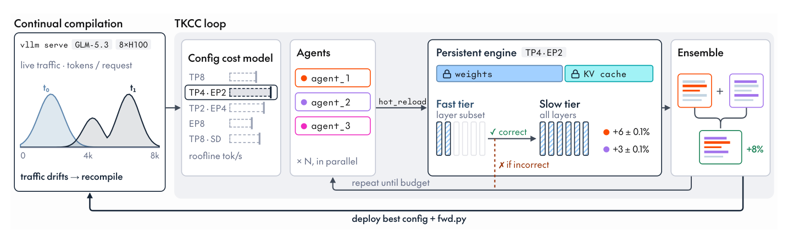

*设计图。* 论文图 1。左侧的流量和硬件约束决定从哪里开始搜，中间的常驻引擎让不同候选共享装载成本。 [原图，第 2 页](https://arxiv.org/pdf/2611.14681v1#page=2)

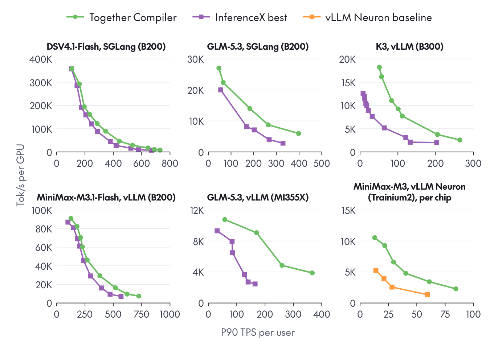

*结果图。* 论文图 7。横轴是每用户 P90 TPS，纵轴是系统吞吐折算到每卡或芯片；比较两条曲线在相同横坐标上的高度。 [原图，第 12 页](https://arxiv.org/pdf/2611.14681v1#page=12)

---

## 2. SEIS：让下一轮继承一台已经改好的引擎

芝加哥大学 · 10 月 3 日预印本

SEIS 固定开发 Agent，从能运行的 mini-sglang 开始。一次 session 的交付既包含代码，也包含做过哪些实验的报告。作者对照独立尝试、沿同一分支继续研究，以及多条分支定期交换发现三种组织方式。最好的引擎保留本分支改过的 kernel、执行路径，又接入另一条分支验证过的解码策略。这个案例说明，跨轮继承的不只是一个“更高的分数”，还包括让后续结构性优化变得可行的一系列前置改动。

**实测结果**　单张 H100、Qwen3-0.6B、单请求，100 个自然长度请求计入 prefill。吞吐中位数从原始 mini-sglang 的 594 增至 1,942 tok/s（3.27×），关闭推测解码仍有 3.08×。开发门槛之外，作者还单独测了数学与检索准确率。

**开放范围**　公开引擎、实验脚本和生成材料。项目主页与实现仓库分开，复现应从后者进入。 [论文全文](https://arxiv.org/pdf/2610.04646v1) · [项目主页](https://nehzux.github.io/SEIS/) · [实现与实验脚本](https://github.com/smth-fun/self-evolving-inference-system)

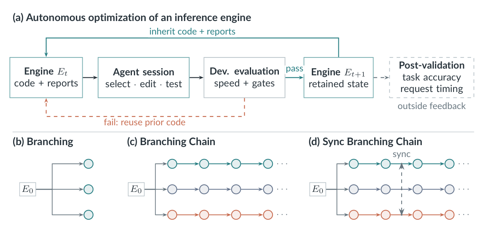

*设计图。* 论文图 2。下排从左到右给出独立试验、串行继承、跨链同步；上排区分用于搜索的开发检查和事后验证。 [原图，第 3 页](https://arxiv.org/pdf/2610.04646v1#page=3)

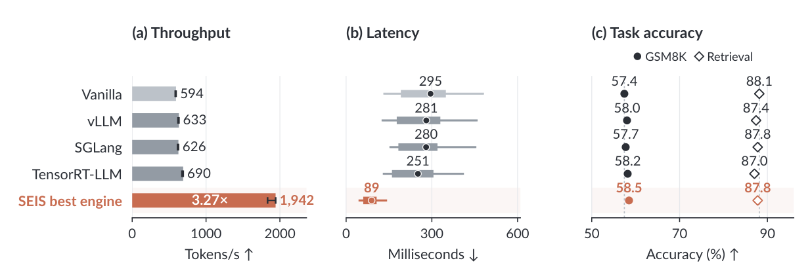

*结果图。* 论文图 1。先看吞吐与延迟，再看同一版本的准确率。3.27× 的分母是原始 mini-sglang；三个成熟引擎各有自己的对照点。 [原图，第 2 页](https://arxiv.org/pdf/2610.04646v1#page=2)

---

## 3. OpenRSI × SGLang-Omni：让可复现的改动进入上游

OpenRSI Foundation 与 SGLang-Omni · 11 月 9 日联合报告

在多模型共用的引擎里，一个模型变快，还要回答其他模型是否退化、改动是否应该默认打开。双方把目标变成包含基线、验证器和预算的可执行任务。研究 Agent 在自己的工作区里反复试验，验证器独立检查，随后有人复现结果、审查代码和默认配置。一个例子是 Qwen3-TTS 的 prefill 与 vocoder 图复用；正式合入也让下一轮优化有了所有维护者共享的起点。这与 SEIS 的继承互补：SEIS 测研究轨迹如何积累，这里记录研究结果如何成为上游版本。

**实测结果**　团队报告覆盖八个模型，合入 14 个 PR。原表按每个模型首个相关 PR 之前和最后一个之后的 main 比较；部分区间还含其他贡献或默认配置变化。非流式和流式的收益差异很大，例如 Fish S2-Pro 在 H100 上分别为 +9.6% 和 +0.3%。

**开放范围**　任务、RSI-Harness、任务构建说明及上游改动均有公开入口。 [联合技术报告](https://index.openrsi.foundation/blog/2026/openrsi-sglang-omni/) · [SGLang-Omni 题包](https://github.com/OpenRSI-Foundation/OpenRSI-Index/tree/main/rsi-tasks/SGNOMI) · [RSI-Harness](https://github.com/OpenRSI-Foundation/OpenRSI-Index/tree/main/RSI-Harness) · [Qwen3-TTS 上游 PR](https://github.com/sgl-project/sglang-omni/pull/2779)

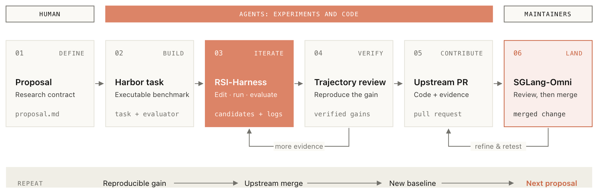

*设计图。* 联合报告图 2。请沿最右端再看回来：只有维护者接受的修改，才会成为下一道任务的上游基线。 [作者原图](https://index.openrsi.foundation/blog/2026/openrsi-sglang-omni/)

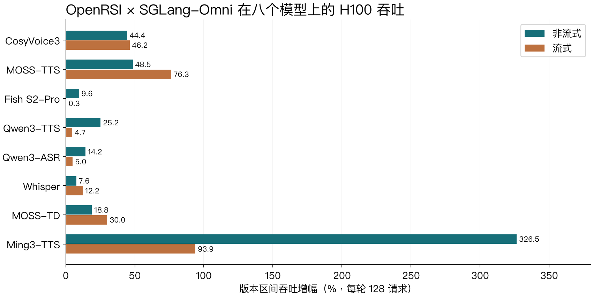

*结果图。* 按联合报告表 1 的 H100 两列重绘，每轮 128 个请求。最大数字来自 Ming3-TTS；该版本区间另含 28 个 PR，图上展示的是整段版本增益。 [原表及归因脚注](https://index.openrsi.foundation/blog/2026/openrsi-sglang-omni/)

---

## 4. InferRSI：把候选的成绩和研究方法的价值分开验证

InferMatrixLab · 10 月实测，11 月 21 日版本核对

InferRSI 为已有推理引擎提供实验工作台。开发 Agent 提出假设、修改代码；实验框架固定模型、输入、基线与质量门槛，记录每轮证据，再用新进程复测选定候选。它还提出第二层比较：让两个独立 Agent 分别在知识库开启和关闭的条件下完成同一道题，检查已有经验对最终速度、用时和资源消耗的影响。前一种实验判定代码值不值得用，后一种实验才有机会回答研究方法有没有变好。

**实测结果**　Qwen-Image-2.1-Turbo 的账本记录了一次 RMSNorm 与 RoPE 融合：算子测试通过，完整图像校验失败，候选撤回。最终组合在四张 B300、预热、重复提示词、并发 1 的条件下，将 HTTP 端到端时延从 384.16 降到 266.60 ms（−30.60%），44 份正式及留出 RGBA 输出逐像素一致。这是候选组合的收益，知识库开关另有独立的比较协议。

**开放范围**　Apache-2.0。工作台代码、冻结协议、逐轮记录、案例脚本和上游补丁可查。 [固定版本代码](https://github.com/InferMatrixLab/InferRSI/tree/9466bc8d910c9fef55d4a9e23ee1a82950280c30) · [工作流](https://github.com/InferMatrixLab/InferRSI/blob/9466bc8d910c9fef55d4a9e23ee1a82950280c30/docs/optimization-workflow-unification.md) · [知识配对协议](https://github.com/InferMatrixLab/InferRSI/blob/9466bc8d910c9fef55d4a9e23ee1a82950280c30/docs/benchmark-comparison.md) · [案例账本](https://github.com/InferMatrixLab/InferRSI/blob/9466bc8d910c9fef55d4a9e23ee1a82950280c30/docs/qwen-image-2.1-turbo-b300.md)

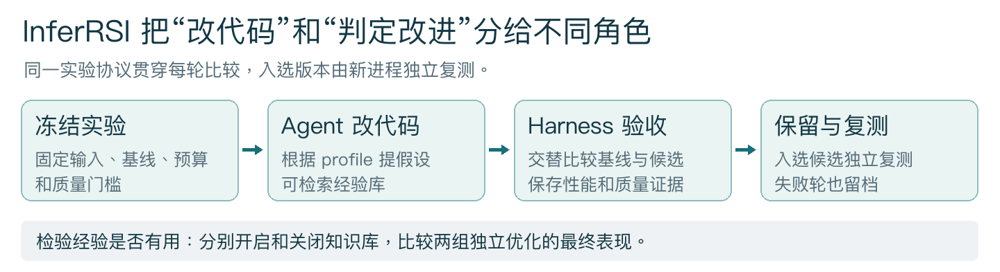

*设计图。* 按项目协议绘制。横向是一轮研究的职责分工；下方的知识开关需要另外运行完整的配对研究。 [设计依据](https://github.com/InferMatrixLab/InferRSI/blob/9466bc8d910c9fef55d4a9e23ee1a82950280c30/docs/benchmark-comparison.md)

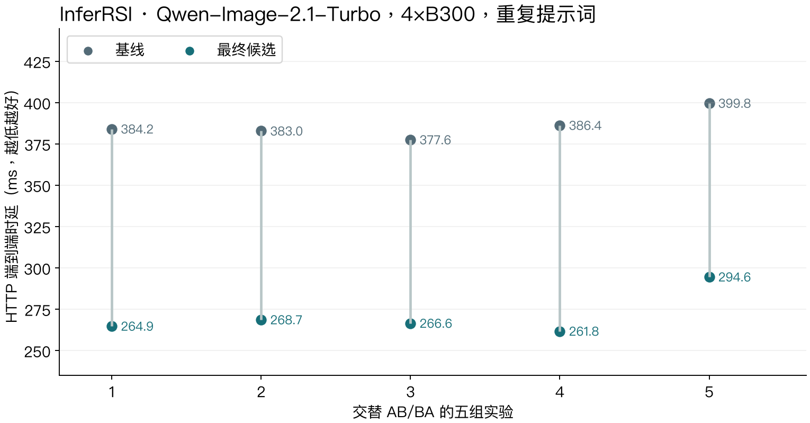

*结果图。* 按最终 H19 原始记录重绘。每个点是三次请求的均值，正式数字取五组均值的中位数；第五组的慢点也保留在图中。 [五组测量原值](https://github.com/InferMatrixLab/InferRSI/blob/9466bc8d910c9fef55d4a9e23ee1a82950280c30/docs/qwen-image-2.1-turbo-b300.md)

---

## 5. InferenceForge：让用户交互速度决定哪些优化值得做

Agent Economics · 11 月 9 日工程报告

优化目标是：每个用户的解码速度至少达到 30 tok/s 时，一张卡还能提供多少总吞吐。Agent 在 SGLang 分支上跑一小时 AgentX 请求，根据缓存命中、逐层 profile 和自己的实验改代码。最直观的发现来自长短请求混排：旧策略只看 batch 大小来划分注意力工作，单个极长请求就能拖住整步。修复给长上下文的读取留下足够的并行度。均匀长度的算子测试很难暴露这个问题，真实流量同时决定了该修哪里和怎样验收。

**实测结果**　Kimi K3、单节点 8×B300，经三天九轮迭代，在每用户至少 30 tok/s 时达到 12.8k tok/s/GPU。作者对照的同门槛最佳公开 AgentX 记录是 8.9k，报告增幅 43%。这是与当时已发表性能前沿的比较；代码贡献还涉及线性注意力和 FP8 KV 打包。

**开放范围**　SGLang fork 与三处主要修复的 PR 公开。此次可核对的公开材料中，整套实验控制器没有独立的源码入口。 [团队技术报告](https://agenteconomics.org/posts/inference-forge) · [SGLang fork](https://github.com/jcaip/sglang-fork) · [长请求切分](https://github.com/jcaip/sglang-fork/pull/3) · [并行扫描](https://github.com/jcaip/sglang-fork/pull/1) · [KV 打包](https://github.com/jcaip/sglang-fork/pull/2)

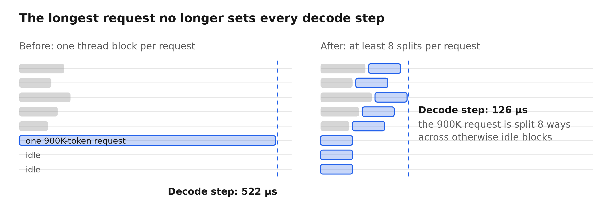

*设计图。* 团队图 2，代表性优化的设计。一个 900K-token 请求在旧切分下占住关键路径，增大切分后该测量的单步耗时从 522 降至 126 μs。 [原图与实现说明](https://agenteconomics.org/posts/inference-forge)

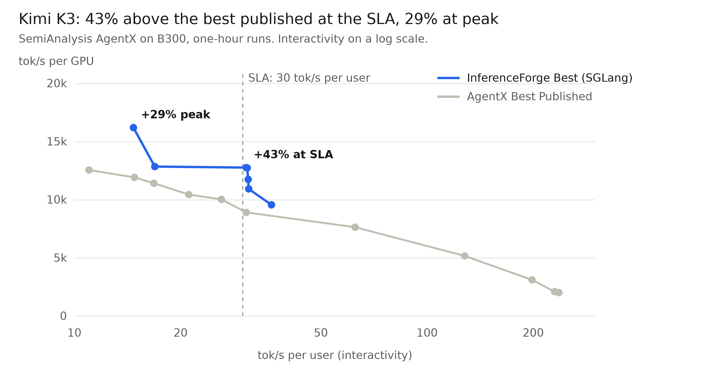

*结果图。* 团队图 5。沿每用户 30 tok/s 的门槛读纵轴，得到受约束吞吐；曲线最高点回答的是另一个并发取舍问题。 [原图及基线来源](https://agenteconomics.org/posts/inference-forge)

---

## 6. EngineTailor：把一个模型的执行路径交给 Agent

清程极智等 · DAI 2026 录用摘要及 11 月团队技术报告

一个工程上值得问的问题是：如果 Agent 大部分预算都花在反复读通用引擎，能否给它一个更合适的起点？EngineTailor 为特定模型、硬件和负载裁出能独立运行的引擎。Qwen3 的实例只有 28 个文件、3,275 行，仍能装载权重、管理缓存、执行模型并输出结果。Manager 按实测瓶颈出题，Worker 在各自的代码副本中实验，候选回到完整路径验收。团队给了一个很好的淘汰案例：Pi0.5 的注意力单测快了 1.497×，一次完整动作推理却多花 56.7 ms，于是舍弃了改动。

**实测结果**　Qwen3 对照中，直接在 SGLang 上的五次尝试合计约 81.39 美元，prefill 和 decode 的变化均小于 1%。目标引擎在初始性能对齐后，以相近优化预算将自身短序列 prefill 加速 3.10–4.05×、长序列加速 1.25–1.41×，decode 持平。这组倍率的分母是目标引擎的优化起点。

**开放范围**　公开可读材料为 DAI 录用摘要和团队详报。完整 EngineTailor 框架的公开仓库未核实；可复用的 APXInf 库以 Apache-2.0 开放，其中 Clef 后端已有合入记录。 [DAI 录用摘要](https://www.adai.ai/dai/2026/accepted-papers.html#:~:text=EngineTailor) · [团队技术报告](https://www.infinigence-ai.com/news-updates/256.html) · [APXInf 代码](https://github.com/infinigence/APXInf) · [Clef 合入记录](https://github.com/infinigence/ApxInf/pull/137)

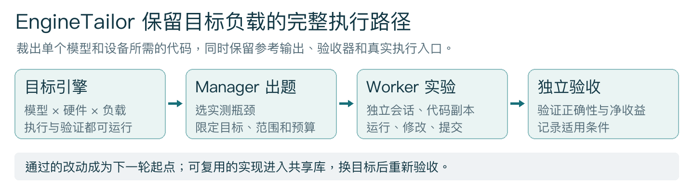

*设计图。* 据团队工作流重绘。实验范围可以缩到一个目标，正确性和端到端验收仍需保留。 [设计依据](https://www.infinigence-ai.com/news-updates/256.html)

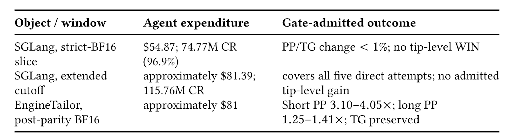

*结果图。* 团队原表。对照中预算相近；应分别阅读起点、短序列、长序列和 decode 四列信息。 [原表所在报告](https://www.infinigence-ai.com/news-updates/256.html)

---

## 7. Herschel：沿生产请求找到 GPU 等待的原因

Alibaba · 9 月 30 日预印本

在 GPU 时间线上，一段空白只说明 GPU 当时没有工作。Herschel 先向运行中的进程短时挂接 Hprof，再按需要补采 Python 调用栈、CPU 活动和跨进程事件，用同一次工作的标识把等待串起来。一个 KV 缓存案例里，worker 空闲是因为引擎主进程正在等远端创建 KV 对象；这个对象到保存缓存时才需要。把创建操作与模型执行重叠，就能消掉前台等待。系统由此取得可复现的触发条件，Agent 在受控环境写补丁，专家审核后部署。

**实测结果**　半年内约 17,000 条 trace，覆盖 120 多种模型变体、10 多种加速器，23% 命中至少一种低效模式。KV 创建重叠在约 50 个部署上落地，相关短上下文 prefill 吞吐提高 3.3–5.7%。另一案例中，Paged Attention 本身耗时下降约 61%，对应部署的每输出 token 耗时下降 8–32%。

**开放范围**　论文公开 Hprof 的挂接、事件关联、案例和生产统计；未核实可公开获取的完整 Herschel/Hprof 实现。 [论文及版本](https://arxiv.org/abs/2609.40247) · [全文](https://arxiv.org/pdf/2609.40247v1)

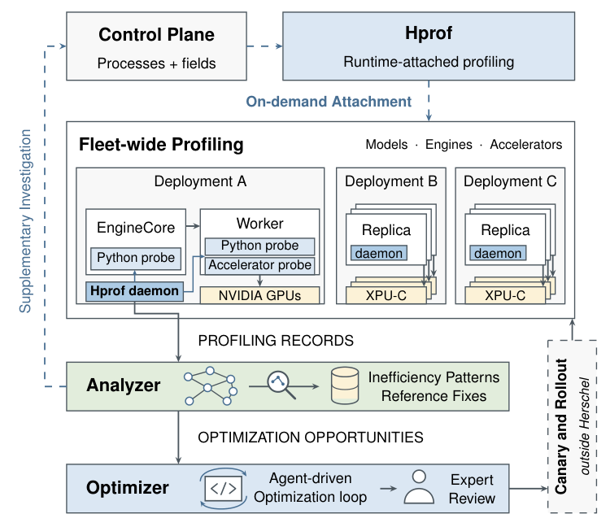

*设计图。* 原论文图 3。先定位异常出现在哪个进程，再决定增加哪些观测，保留短窗口采样的成本优势。 [原图，第 4 页](https://arxiv.org/pdf/2609.40247v1#page=4)

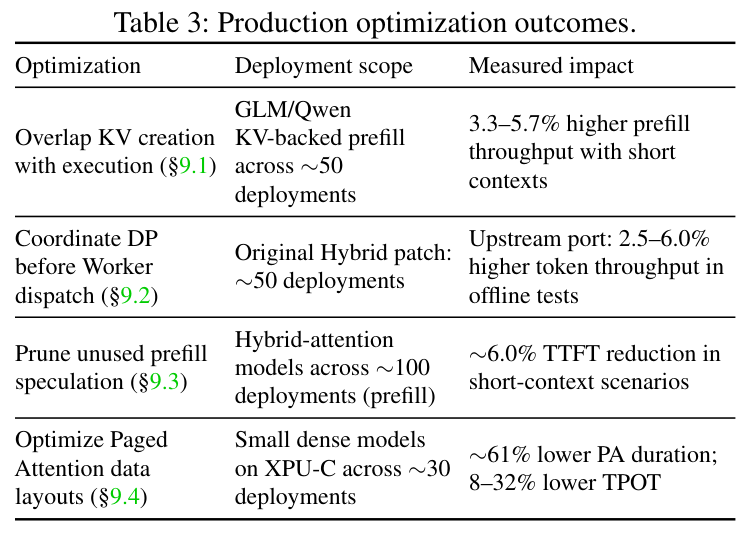

*结果图。* 原论文表 3。四行是不同问题、不同部署的结果；并排的算子耗时和服务指标最能说明优化怎样兑现。 [原表，第 9 页](https://arxiv.org/pdf/2609.40247v1#page=9)

---

## 8. SkySynth / JITEngine：同一个模型，两台机器，两种引擎

Berkeley Sky Computing Lab 等 · 11 月 4 日 JITEngine 技术发布

SkySynth 让候选程序与检查它的测试一起演化。JITEngine 将这套方法用在一个具体任务上：为三种模型各生成两台 Mac 上的推理引擎。同一个模型移到第二台机器时，系统从第一台的代码继续研究，同时重新验证设备约束。Qwen3.6 说明了为什么要这样做：在 M4 Pro 上，验证一个投机 token 额外花费约为一次解码步的 21%；在 M2 上则升到 65–73%。前者采用投机解码，后者把预算转到专家权重读取和 GPU 命令提交。

**实测结果**　单用户 decode 的三组同机比较分别为：M4 Pro 上 Flash-Next 为 32.9 对 12.1 tok/s（slotstream）；M2 上 Qwen3.6 为 44.9 对 32.9（llama.cpp + MTP）；M4 Pro 上 Flint 在 252K 上下文为 27.7 对 22.6（rec）。三个比较各自对应一个公开实现。

**开放范围**　研究框架 SkyDiscover 和生成的 JITEngine 引擎均公开，采用 Apache-2.0。两篇团队报告分别解释研究方法和这一批引擎的逐机实现。 [SkySynth 方法报告](https://skydiscover-ai.github.io/blog-skysynth.html) · [JITEngine 技术报告](https://skydiscover-ai.github.io/blog-jitengine.html) · [研究框架](https://github.com/skydiscover-ai/skydiscover) · [引擎代码](https://github.com/skydiscover-ai/jitengine)

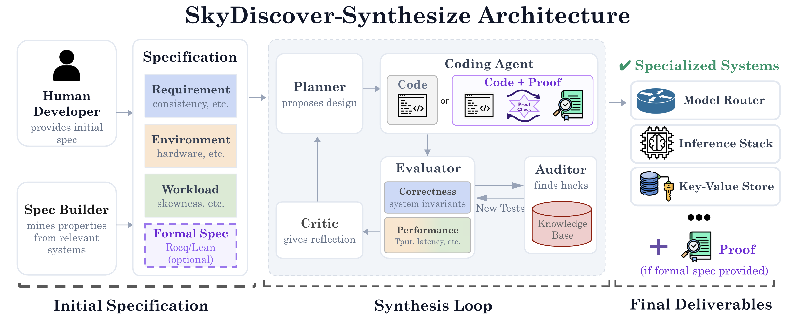

*设计图。* SkySynth 报告原图 2。候选与验证机制共同演化；Mac 案例使用可执行测试检验输出和设备行为。 [设计原图](https://skydiscover-ai.github.io/blog-skysynth.html)

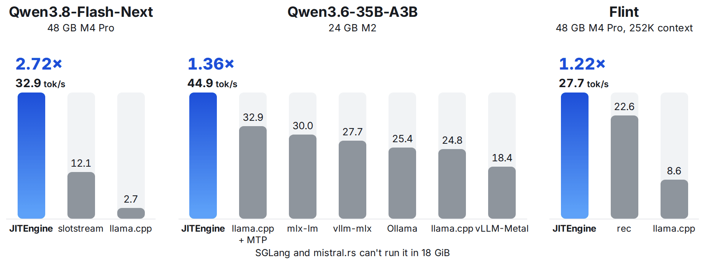

*结果图。* JITEngine 原图 1，取动图最后一帧。每个模型与同一台 Mac 上能运行它的服务实现比较。 [结果原图](https://skydiscover-ai.github.io/blog-jitengine.html)

---

## 9. Evolving Infra：让运行中的集群适应 Agent 负载

Georgia Tech、UIUC、Berkeley、MIT 等 · 11 月 9 日预印本，11 月 12 日修订 · 合作者包括 Song Han、Ion Stoica

编码、解题和操作电脑的 Agent 在不同阶段产生长短差异很大的输入，也会派生或放弃上下文分支。固定的 prefill/decode（P/D）机器配比容易让一侧排队；节点切换角色时，仍有价值的 KV 也可能丢失。Evolving Infra 将节点的计算角色与 KV 缓存归属解耦。在线规划器按请求构成调整 P/D 配比；分布式 KV 管理器利用上下文分支的存活信息决定保留或驱逐哪些前缀，并异步取回缓存。这是理解“为 Agent 服务的系统如何演化”的代表。

**实测结果**　使用 GLM-5.2 与 Kimi K2.6，在最多 256 张 GB300 上回放编码、数学、计算机使用负载。相对 NVIDIA Dynamo，平均请求端到端时延最高降至其 1/4.1，P95 首 token 时延最高降至其 1/14。图 6 中每个配置的平均端到端时延均改善；尾延迟随负载与并发变化，两个峰值应分别阅读。

**开放范围**　系统源码公开，仓库提供 MIT 许可证以及运行说明。 [项目主页](https://inference-rsi.com/) · [论文全文](https://arxiv.org/pdf/2611.12304v2) · [代码](https://github.com/mit-han-lab/EvolvingInfra)

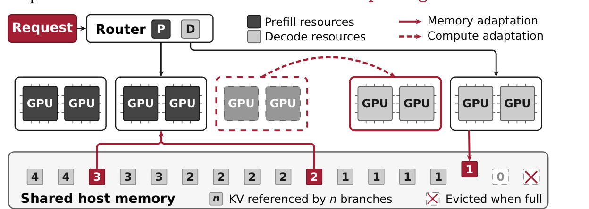

*设计图。* 原论文图 1 的架构部分。释放计算角色与缓存的绑定后，节点切换和前缀保留可以分别决策。 [原图，第 1 页](https://arxiv.org/pdf/2611.12304v2#page=1)

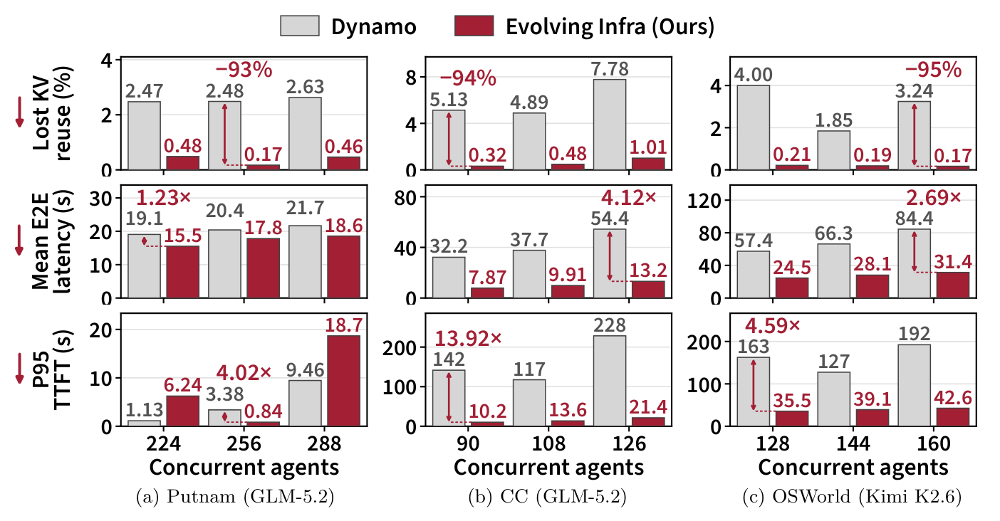

*结果图。* 原论文图 6。横向区分三类 Agent 负载，纵向依次看丢失的 KV 复用机会、平均请求时延和 P95 首 token 时延。 [原图，第 11 页](https://arxiv.org/pdf/2611.12304v2#page=11)

---

## 10. InfraRSI：把失败的训练实验也纳入下一轮搜索

InfraRSI Team / TokenRhythm · 11 月 8 日预印本

训练中的配置收益强烈依赖组合。某个融合算子或通信设置能缩短一步训练时间，却可能单独开启就 OOM。InfraRSI 先冻结工作量、损失检查和计时规则，测量机器噪声，再一起搜索启动参数和源码补丁。一次 OOM 虽然没有步耗时，却提供了峰值显存超出容量的观测；系统保留它，等找到释放显存的改动后重新组合试验。入选候选与原基线背靠背复测，跨机器继承的经验也要在新目标上重新验证。

**实测结果**　在四个单机或多机的 dense/MoE 训练负载上，相对各自原始配置的几何平均加速为 1.83×，单项最高 2.75×。四项平均模型浮点利用率（MFU）从 17.4% 升至 30.0%。同组实验中 OptiCo、Auto-Research、RE-Bench 的几何平均加速分别是 1.23×、1.34×、1.37×。

**开放范围**　项目公开研究 Agent、执行逻辑和测试。核查时仓库根目录未列明标准许可证；复用可单独向作者确认授权范围。 [项目主页](https://infrarsi.github.io/) · [论文全文](https://arxiv.org/pdf/2611.11558v1) · [代码](https://github.com/TokenRhythm/InfraRSI)

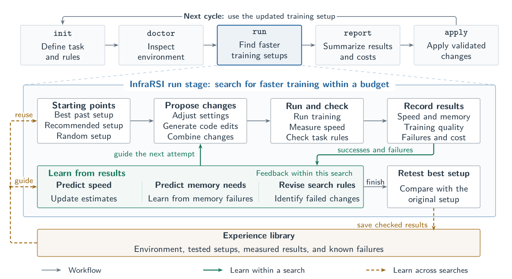

*设计图。* 原论文图 1。从固定验收契约，到联合搜索与复测，再把通过的补丁应用回源代码。 [原图，第 2 页](https://arxiv.org/pdf/2611.11558v1#page=2)

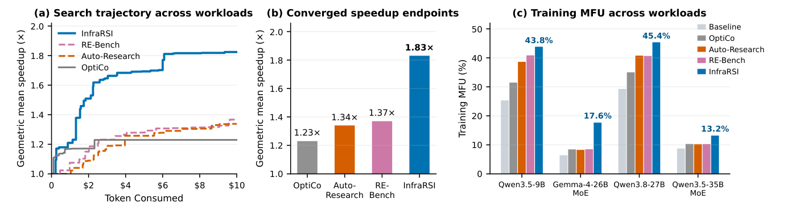

*结果图。* 原论文图 2。先看各负载相对自身起点的加速，再看四项几何平均，最后看硬件利用率。 [原图，第 12 页](https://arxiv.org/pdf/2611.11558v1#page=12)

---

## 11. Apple RSI-Inference Bench：在同一个引擎上，接入模型与优化模型有多难？

Apple AIML Research · 10 月 16 日发布代码，本文采用 10 月 25 日榜单快照

一个 Agent 能把已有模型跑快多少，能说明它也会把新模型接入引擎吗？Apple 把这两种能力放进同一套基准，同时保留各自的成绩。每道题给出一个固定版本的 vLLM 或 SGLang、目标模型和 1–8 张 GPU。Agent 最多有 8 小时离线阅读、修改和实测。时间到后，独立验证器构建修改过的引擎，真正启动模型服务，用隐藏用例检查它交付的行为。这样，其他团队也能把自己的 Agent 放在同一个起点上比较。[评测协议](https://github.com/apple-aiml-research/ml-rsi-inference-bench/blob/1a38072fbe284234c874356b86c9df666a5a79a3/README.md)

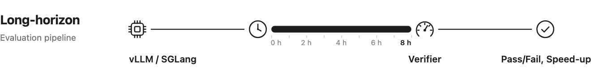

*图一 · 怎样验收一次提交。* 左边的 GPU 和时间预算属于开发阶段，右边的验证器负责最终判分。两段分开，Agent 才有自由试验，成绩也能跨提交比较。[官方流程原图](https://github.com/apple-aiml-research/ml-rsi-inference-bench/blob/1a38072fbe284234c874356b86c9df666a5a79a3/assets/g-rail-light.svg)

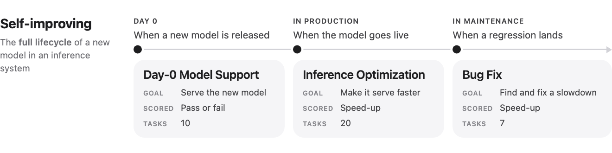

*图二 · 为什么有两种分数。* 37 题中，10 题要求新模型在指定部署完整通过，按首次尝试通过率（pass@1）计分。20 道优化题和 7 道性能回退修复题都从可运行的基线出发，汇总各题实测加速比的几何平均；正确性失败按 1.00× 计入。[官方任务原图](https://github.com/apple-aiml-research/ml-rsi-inference-bench/blob/1a38072fbe284234c874356b86c9df666a5a79a3/assets/g-lifecycle-light.svg) · [计分说明](https://github.com/apple-aiml-research/ml-rsi-inference-bench/blob/1a38072fbe284234c874356b86c9df666a5a79a3/README.md)

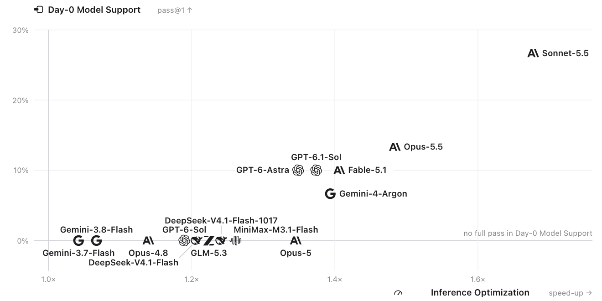

*图三 · 能提速与能接入，在同一张榜上呈现出不同的难度。* 10 月 25 日快照中，Sonnet-5.5 的优化成绩为 **1.68×**，新模型接入 pass@1 为 **26.7%**。15 个参评 Agent 中有 **9 个**在新模型接入题上没有一次完整通过，而这九个在优化赛道均获得了高于 1× 的几何平均加速。散点图横轴看提速，纵轴看接入；只报告一个总排名会掩盖这个差异。[官方交互榜单](https://rsi-inference.com/) · [对应版本的图与数据](https://github.com/apple-aiml-research/ml-rsi-inference-bench/blob/1a38072fbe284234c874356b86c9df666a5a79a3/docs/leaderboard.html)

**开放范围**　官方仓库包含任务、执行工具、评分说明和榜单快照，采用 Apple Sample Code License。[固定版本仓库](https://github.com/apple-aiml-research/ml-rsi-inference-bench/tree/1a38072fbe284234c874356b86c9df666a5a79a3) · [许可证](https://github.com/apple-aiml-research/ml-rsi-inference-bench/blob/1a38072fbe284234c874356b86c9df666a5a79a3/LICENSE)

---

## 12. Sol-H3：先减少生成视频所需的计算，再让每一步跑快

NVIDIA Research · 9 月 28 日技术报告 · MiniMax-H3 视频与音频生成

视频扩散的早期步骤在决定场景布局，后期才补足高频细节。Sol-H3 的设计者利用这个差异，在低分辨率上起草，再在目标分辨率上细化。两个阶段使用不同的潜空间，一个学到的转换器直接连接它们，省去中间先解码到像素、再重新编码的往返。RSI 接手的是另一层工作：针对给定实现做 profiling，搜索融合、内存布局和通信方案，再用参考实现检验候选。论文明确交代了两层分工，因此读者可以分别判断系统为何更快，以及自动搜索具体交付了什么。[论文 §3、§7](https://arxiv.org/html/2609.35110v1) · [项目主页](https://nvlabs.github.io/Sana/Sol-Engine/Sol-H3/)

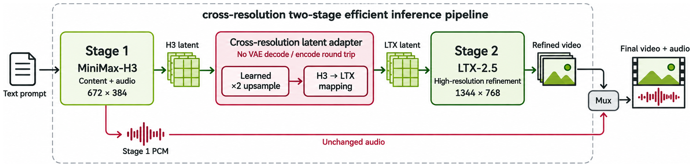

*图一 · 哪些计算可以省掉。* 论文图 2 展示两段流水线。先在 672 × 384 下生成粗略布局，再放大、转换潜表示，最后在 1344 × 768 下细化。跨阶段传递的始终是潜表示。[论文图 2](https://arxiv.org/html/2609.35110v1#S3.F2)

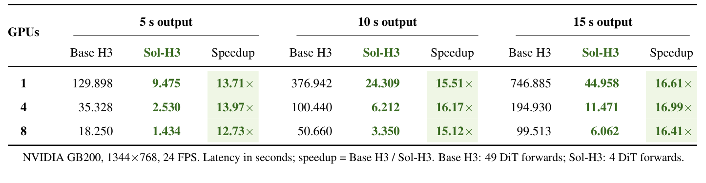

*图二 · 整机究竟快多少。* 原论文表 1 在相同输出分辨率和 24 FPS 下，分别固定 GPU 数与视频时长。看 **8×GB200** 这一行，生成 5 秒视频从 **18.250 s 降至 1.434 s（12.73×）**，15 秒视频从 **99.513 s 降至 6.062 s（16.41×）**。此表比较 49 次与 4 次去噪计算，计时从文本编码到音视频解码与同步，模型加载、编译、预热和 MP4 编码在计时窗口之外。[论文表 1](https://arxiv.org/html/2609.35110v1#S6.T1)

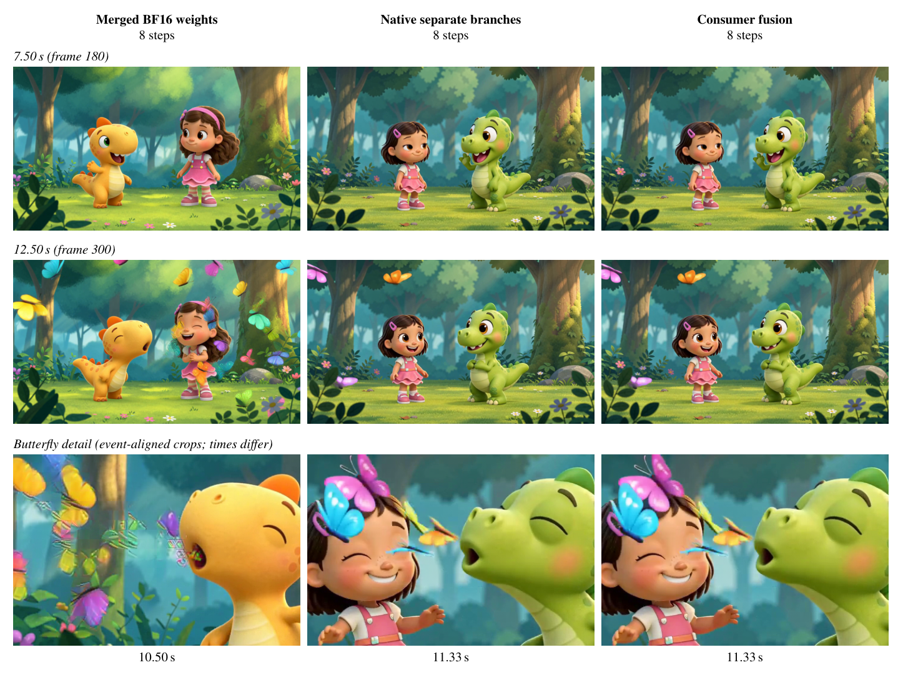

*图三 · 为什么还要验生成结果。* 论文图 8 固定提示词、初始噪声和采样设置。左列预先合并 BF16 权重，连蝴蝶出现的时间都变了；中列原生 LoRA 和右列在消费端融合的实现在这次实验中输出逐字节一致。配套表 5 给出四张 GB200 上八次去噪计算的流水线中位时延，原生分支 **26.283 s**、消费端融合 **25.589 s**、预合并权重 **24.785 s**。这一组实验把局部优化的速度和数值代价放到了一起。[论文图 8](https://arxiv.org/html/2609.35110v1#S6.F8) · [对应时延，表 5](https://arxiv.org/html/2609.35110v1#S6.T5)

**开放范围**　作者在 NVlabs/Sana 的 `sol-engine` 分支发布了 MiniMax-H3 推理代码、按硬件区分的运行目录、LoRA 融合说明与测试。[固定版本源码](https://github.com/NVlabs/Sana/tree/cf67a3acad7511acb85053e56a05e5dd24c82ba0/models/minimax_h3) · [论文 PDF](https://arxiv.org/pdf/2609.35110v1)

---

## 放在一起看，什么值得借鉴？

**第一，工作负载本身是一项设计选择。** SEIS 把 H100 上小模型单请求做成容易反复检验的起点；InferenceForge 用混合长短请求揭示 batch 中的慢请求；Herschel 从生产进程反向寻找复现条件。三者回答的问题依次是“这条执行路径还能多快”“服务在用户速度约束下还能承载多少流量”“究竟哪种浪费在真实部署反复发生”。汇报中并列这三个例子，比给峰值倍率排座次更能解释它们的贡献。

**第二，研究能积累什么，取决于下一轮继承什么。** SEIS 继承代码和实验报告，InferRSI 让经验库接受开关对照，OpenRSI 则把经过审查的改动合入上游。由此产生三种可单独检验的结果：候选代码变快、下一位 Agent 更容易找到改进、所有用户获得新的默认实现。一个项目可能只证明了其中一项。

**第三，对 RSInfer 最有价值的是连接系统与算子两个尺度。** 系统 Agent 看得到真实的调用频率、布局、路由和服务指标，适合定义题目及决定采用条件。专用算子 Agent 可以在固定契约下持续做 profiling、修改和复验。交回源码和逐场景测量后，再由系统 Agent 消除接入开销、在完整请求路径上复核。EngineTailor 中那次“算子快 1.497×、完整推理多花 56.7 ms”的实验，足以说明为何这个采用决定应留在系统侧。

汇报时可用 **Herschel → Together Compiler → SEIS → OpenRSI** 讲一条完整研发路径：在哪里发现问题、怎样降低每轮试验成本、跨轮如何积累、谁决定采用。再用 **InferenceForge 与 Evolving Infra** 展示两种服务收益：前者由开发 Agent 离线改引擎，后者由引擎在运行期间实时调配资源。
