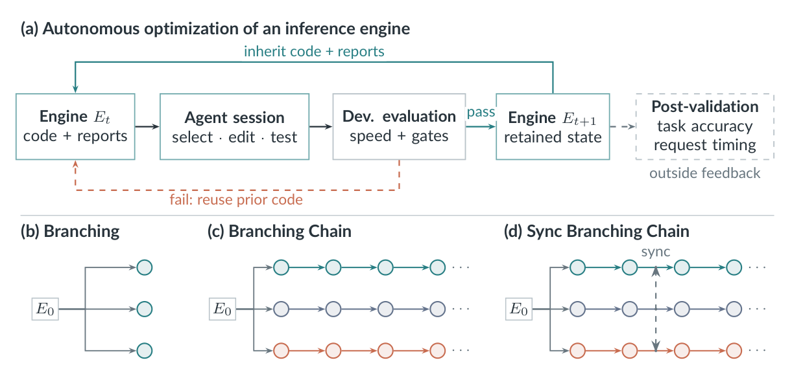
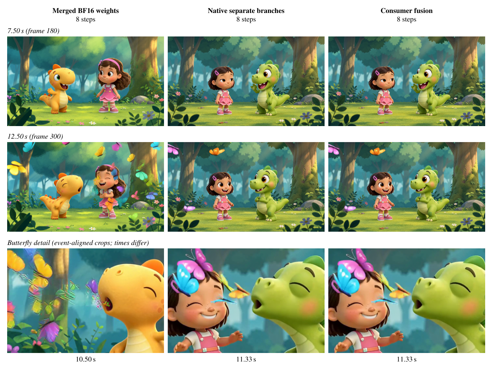
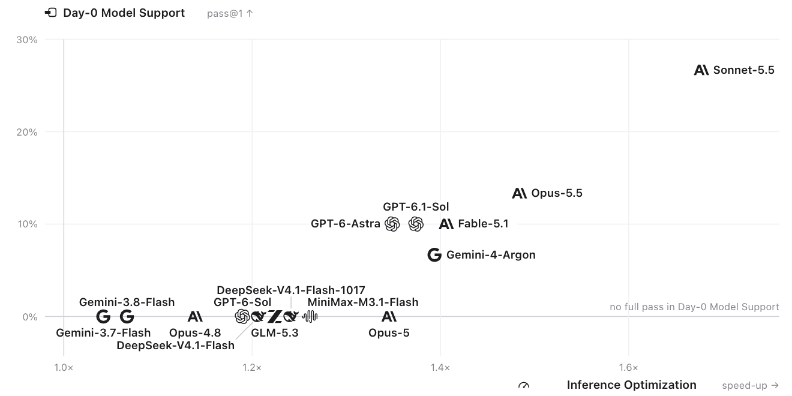

# Three experiments that explain infra RSI

[Project index](../README.md) · [Full English survey](2026-11-inference-infra-rsi.md) · [十二项工作的中文图文综述](2026-11-inference-infra-rsi.zh-CN.md)

A published speedup can describe three different things: a better engine, a faster pipeline that does less work, or an agent that succeeds across a suite of engineering tasks. These three experiments give each claim its own test.

## SEIS · What survives between experiments?

Start with a small inference engine that already runs. An agent edits the code, measures the result, and writes down what it tried. The next session can start fresh, inherit one branch, or receive findings from another branch. These choices change the research process while keeping the target model and hardware fixed. The practical question is whether a later idea depends on work that an isolated session would need to rediscover. [Paper, method and evaluation](https://arxiv.org/abs/2610.04646)

*Figure 2, SEIS.* The lower row compares ways to connect research sessions. The upper row separates the development checks from validation of the retained engine. [Original figure](https://arxiv.org/pdf/2610.04646v1#page=3)

The strongest engine reached **1,942 tok/s** for natural-length, single-request Qwen3-0.6B on one H100, compared with **594 tok/s** for the initial mini-sglang. Turning speculation off still left a **3.08×** speedup over that starting engine. That ablation matters: most of the measured gain survived removal of one conspicuous late-stage strategy. [Results and ablation](https://arxiv.org/pdf/2610.04646v1) · [Implementation](https://github.com/smth-fun/self-evolving-inference-system)

## Sol-H3 · Which change is allowed to affect the output?

The video generator first establishes a scene at low resolution, then refines it at high resolution. That algorithm changes how much denoising work the pipeline does. Within the new pipeline, operator research has a different contract: some implementations must reproduce a particular reference. The LoRA experiment makes the distinction visible. [Full-stack design](https://arxiv.org/html/2609.35110v1#S3.F2)

*Figure 8, Sol-H3.* Read across each row with the prompt and seed held fixed. The butterfly burst happens at a different time in the merged-weight run. The separately computed branches and consumer-side fusion agree byte for byte on the tested generation. [Original figure](https://arxiv.org/html/2609.35110v1#S6.F8)

With four GB200s and eight denoising evaluations, consumer fusion reduced median pipeline time from **26.283 s to 25.589 s**. Merging BF16 weights was faster again at **24.785 s**, with different output. Those numbers isolate an implementation decision. The paper reports its larger coarse-to-fine pipeline speedups in a separate experiment with a different baseline. [LoRA timing](https://arxiv.org/html/2609.35110v1#S6.T5) · [Full-pipeline timing](https://arxiv.org/html/2609.35110v1#S6.T1)

## Apple RSI-Inference Bench · What does the score say about the agent?

Get an unsupported model running, improve a supported model, or fix a regression. Each task gives the agent a real engine and GPU access; a separate verifier builds and evaluates the result. Full passes measure new-model support. Measured speedups are combined geometrically across optimization and regression tasks, with a correctness failure scored at 1.00×. [Tasks and scoring protocol](https://github.com/apple-aiml-research/ml-rsi-inference-bench/tree/1a38072fbe284234c874356b86c9df666a5a79a3)

*Official leaderboard, October 25, 2026 snapshot.* Moving right means greater average speedup. Moving up means more attempts fully passed on new-model support. Look first at the agents on the bottom edge. [Leaderboard source and data](https://github.com/apple-aiml-research/ml-rsi-inference-bench/blob/1a38072fbe284234c874356b86c9df666a5a79a3/docs/leaderboard.html)

Nine of the fifteen agents scored above 1× on optimization yet recorded no full pass on new-model support. The top result reached **1.68×** on optimization and **26.7% pass@1** on support. A serving team choosing an agent for a new architecture would learn little from the throughput score alone. [Interactive results](https://rsi-inference.com/)
